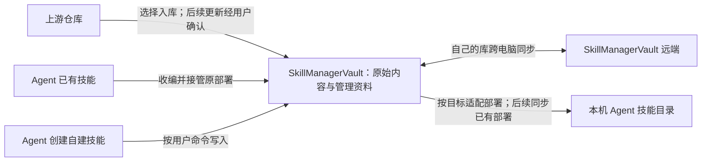

# Skill Manager 需求记录

项目正式名称为 **Skill Manager**，于 2026-10-15 确认，按用户最新要求统一采用带空格的写法。

本文件是需求访谈记录，包含核心管理要求、当前产品实现的暂定范围及尚未确定的问题，不是完整的 Spec（规格说明）。不能把每条“已确认”“已裁决”都当作规格条款。有用的接入数据、视觉素材和工程经验已整理为本项目的[技术参考](technical-reference/README.md)，仅供相关实现按需查阅，不作为旧需求、旧架构或旧测试的继承依据；本项目以自己的原则、规格与讨论为准。

## 核心管理要求：后续 Spec 的依据

2026-10-14，用户明确：真正纳入规范的是对技能管理的要求，实现细节只属于当前产品实现的暂定范围。已明确的核心管理要求包括：

- **一体式库管理与部署**：直接管理一个 SkillManagerVault 根目录，其中编码与龙虾技能分开管理；技能须先明确进入对应管理域的库，再部署给该域的 Agent（代理）。支持收编 Agent 已有技能并接管其部署。支持 GUI（图形界面）管理，所有核心技能管理操作都能通过供 Agent 使用的 CLI（命令行）完成。配套管理操作 Skill 是 SkillManagerVault 中的普通技能，开发时写好并入库，后续开发同步更新库中的该技能，使其与软件管理能力一致。
- **技能管理资料**：多个标签、目录即分类、中文正文翻译、中文短注释、可修改的 Agent 与 OS（操作系统）支持声明，以及按 Agent 和系统选择的 overlay（覆盖层）。覆盖层适用于自建技能和有上游的技能。未声明支持范围时视为全支持。
- **管理资料与原始内容的边界**：每个技能的 `.manager` 保存管理资料，分类由实际目录决定；中文注释在部署时加入，不因注释回写库内原始技能内容。上游不带管理资料时保留本地资料；上游提供同项管理资料时直接采用上游值，不做管理资料冲突裁决。用户维护的目录分类仍保留。
- **多电脑同步与本机部署**：技能库和管理资料跨电脑同步，部署记录由各机器分别维护；无冲突的库更新静默同步并更新本机已有部署，创建或新增入库与首次部署按用户命令分别执行。
- **上游获取与更新管理**：支持从来源仓库选择技能入库，检查上游变化，展示已有技能的变化和新增候选，由用户决定更新及新增入库；GUI 和 CLI 均支持相关流程，CLI 具备全库变更检查能力。SkillManagerVault 自身同步与外部上游更新须区分。

以上是核心要求概览，不替代后续完整 Spec，也不预先锁定未讨论的管理规则。下文保留访谈原始结论作为背景和设计依据；具体按钮、页面、引擎、认证接入方式、维护命令及实现参数，不因被确认就自动升级为 Spec。

## 裁决的解释与调整规则

2026-10-14，用户明确：本次大量裁决并不等于 Spec。核心技能管理要求是规格依据；其余功能入口与技术细节属于当前产品实现的暂定范围，不应被后续 Agent 当作强制规格或永久技术禁令。“移除”“不保留”表示当前范围不纳入该能力；“暂不保留”表示当前尚无明确实际应用场景，先不安排实现。

后续发现实际需要时，应依据具体场景和后果重新评估；不得为了遵守暂定范围而回避必要能力、强行绕路或采用更复杂的替代方案。满足核心管理要求的实现细节可以调整，说明实际问题、理由和最小充分方案并更新记录，不必仅因偏离早期细节裁决就再取得一次许可。涉及改变核心管理要求时，再将具体问题带回需求讨论。不能以假想风险为由扩大范围，也不能把所有已移除功能自动恢复。

用户进一步明确：新软件按照自身规则管理，不搬运旧软件数据，不提供旧数据兼容或迁移逻辑。旧标签数据库到 `.manager` 的迁移工具不纳入。参考包提供知识和资产参考，不因此要求恢复旧软件的管理状态或兼容旧数据路径。

## 产品目标

管理 Skill（技能）库，并将技能安装到不同的 Code Agent（编码代理）和 Lobster Agent（龙虾代理）。

2026-10-15，用户重申产品出发点是对技能的掌控感：能看清库内有哪些技能、用途及分类、安装到哪些 Agent 和 Hermes 档案，能持续修改并调整使用范围。龙虾库存在正文、注释、分类、标签及档案分配的高频变化，并混合自建与上游技能；不能只按一次整理后长期不变的静态库设计。

## 技能管理的整体业务流程：访谈整理

用户指出逐项盘点旧功能的访谈掩盖了真实需求，要求先把技能管理的整体需求和业务流程串联起来。工具中心专题暂停；后续先按完整使用场景检验主流程，不继续以旧功能编号推动访谈。本节是对已有结论的整理，供用户整体校正，不新增规格或实现机制。该流程现已由 [002 规格](../specs/002-skill-management/spec.md) 的 User Stories 按完整业务旅程承载。

产品主线：把不同来源的技能纳入自己维护的 SkillManagerVault，在库中整理、理解和适配，再提供给本机不同 Agent 使用；持续吸收经用户批准的上游变化，并在多台电脑之间共享自己的维护成果。

### 1. 获得技能：先进入自己的库

- 上游技能：提供来源仓库，选择需要的技能入库；多技能仓库默认用仓库名分类，单技能仓库不自动分类。保留来源关系，用于后续仓库级更新检查。
- 已安装技能：在本机 Agent 的列表中看到未受管技能，通过 GUI 或 Agent 调用 CLI 收编；技能进入 SkillManagerVault，同时接管原有部署，不要求再部署一次。
- 自建技能：让 Agent 按规范在 SkillManagerVault 中创建；只要求创建时不首次部署，要求部署时再执行部署。
- 编码与龙虾技能分别进入对应库。库间复制保留原件，两份独立管理；进入另一个库并不等于自动部署。

### 2. 维护技能：库中保存自己的整理与适配成果

用户最初提出的六项管理能力都服务于这一环节，并在后续阅读和部署中发挥作用：

| 管理内容 | 在业务流程中的作用 |
|---|---|
| 多个标签 | 从不同用途查找和组合技能 |
| 一级目录分类 | 快速聚类；修改分类即移动实际目录 |
| 中文正文翻译 | 在管理器中理解技能；不作为部署正文 |
| 中文短注释 | 在管理器及部署后的 Agent 中快速辨认用途，保留原技能名 |
| Agent 与系统支持声明 | 决定技能可部署到哪些目标；未声明默认全支持，受库的管理域约束 |
| overlay（覆盖层） | 保存工具或系统专用适配，部署时添加或替换相应文件 |

除目录分类外，这些资料保存在技能自己的 `.manager` 中。中文注释只在部署时加入，不因管理资料回写库内原始正文；阅读译文与部署正文分开。翻译和适配资料可由 Agent 或人工维护，不推定软件自动生成。原始内容的正式修改在库中完成。

### 3. 使用技能：从库部署到本机目标

用户决定将哪些技能提供给哪些 Agent，可单项、多选或按预设部署。部署遵守技能的 Agent 和系统支持范围，按目标合成原始文件、覆盖层及中文注释；不携带 `.manager`。共享目录部署沿用已确认的内容通用要求及读取假设，不意味着 Agent 实际读取能力已验证。

已有部署随库中部署内容的变化更新：GUI 保存触发同步；Agent 编辑库文件后调用 CLI 完成同步。新建或新增入库的技能不自动首次部署。每台电脑分别决定部署目标；预设是可复用组合，不是互斥的唯一当前状态。

龙虾库到 Hermes 的使用链路为：进入龙虾库 → 部署到 Hermes default → 在其他档案中明确选择启用；新技能不自动在其他档案启用。档案独有技能收编后进入库并部署到 default，原档案启用状态保留。

### 4. 持续维护：分清两种更新

**上游仓库变化**：检查来源仓库 → 展示受影响技能及变化文件 → 用户决定更新和新增入库 → 更新库 → 同步本机已有部署。自维护 Gitea 上游也走显式确认；同一仓库在两库有技能时只检查一次。改名按删除与新增处理，拒绝入库的新增候选记住决定。

上游更新时，用户维护的目录分类保留；上游未带管理资料时保留本地资料，上游提供同项管理资料时采用上游值。这是后续访谈确认的规则，不能用早期“全部保留”覆盖它。

**自己的 SkillManagerVault 变化**：本机维护完成后上传自己的库 → 其他电脑拉取库变化 → 无冲突静默应用 → 更新各机已有部署。技能、管理资料和预设共享，部署记录与 Hermes 档案启用名单留本机。两种更新不能混成同一个“全部更新”动作。

受管部署副本发生外部修改时，暂停该技能的覆盖，由 Agent 检查、用户决定；保留的修改整理回 SkillManagerVault 后再同步。库跨电脑同步冲突也交 Agent 检查、用户裁决，不增加专门的冲突合并产品流程。

### 5. 用完整场景继续访谈

下一步围绕“获得一个上游技能并完成适配和部署”“创建或收编一个自建技能并持续维护”“在另一台电脑继续使用同一技能库”检验链路是否符合用户实际工作。先确认这些场景中的动作、结果和用户决策，再安排库格式及部署合成等必要设计；按钮、旧版入口和技术选型不再作为访谈主线。工具中心与其他辅助功能后置，不因本次暂停而移除。

### 当前访谈焦点：上游维护与自己的库如何配合

用户进一步明确，最重要的是上游仓库的维护方式：既要保留自己添加的 `.manager` 管理层，又能随时获取上游更新，同时支持多电脑同步及提交。接下来的访谈先检验这一完整工作流，不继续讨论辅助功能。

来源仓库更新经用户确认后进入库；自己的管理资料与更新后的技能内容随 SkillManagerVault 同步。上游未提供管理资料时，本地资料保留；同项上游资料优先的既定规则尚未被本次表述撤销。物理组织与版本管理关系已按下述方案确认。

用户已明确“可以提交”指提交自己的 SkillManagerVault，不提交回来源仓库，日常维护基本在 SkillManagerVault 中完成。完整链路为：从来源仓库选择技能入库 → 在 SkillManagerVault 中维护技能及 `.manager` → 提交推送自己的库 → 其他电脑同步并继续维护；后续上游更新仍单向进入 SkillManagerVault，经确认应用后再提交同步自己的库。不增加来源仓库写入、推送或贡献流程。

用户已确认维护方案：选中的技能以普通文件目录进入对应技能库，技能内容及 `.manager` 一起由 SkillManagerVault 自己的 Git 跟踪；按来源仓库登记入库技能与上游路径、当前采用版本等资料，用于后续仓库级更新。日常维护、提交与多电脑同步均围绕 SkillManagerVault 完成，来源仓库不作为库内独立提交推送单元。来源记录格式、上游获取与文件更新的具体实现留到后续设计。

## 技能库的组织

用户已裁决保留旧版 B01：编码技能库与龙虾技能库分开管理，各自维护技能清单，允许两边存在同名技能。后续已确认两库位于同一个 SkillManagerVault，由其 Git（版本管理）仓库统一跟踪。

用户已裁决调整旧版 B02：应用只管理一个指定的技能库根目录，例如 `SkillManagerVault`，直接在该目录中管理技能。两类技能库在这个统一根目录内分别组织；不再使用旧版 `.skills-manager/skills` 等目录另存一套中央库内容。此边界针对库内容，不排除另存本机设置或部署记录。

用户已认可当前库布局：SkillManagerVault 根目录下以 `code/` 和 `lobster/` 区分两类技能。未分类技能放在 `code/技能名` 或 `lobster/技能名`；有分类时放在 `code/分类名/技能名` 或 `lobster/分类名/技能名`。分类最多一级，管理资料文件格式等细节另行设计。

用户已确认首次接入必须已有本地 SkillManagerVault 仓库，应用选择并直接管理这个本地仓库，不提供从远端地址克隆 SkillManagerVault 的首次接入入口。此边界不影响接入后的远端拉取、自动提交与推送。

用户已确认 SkillManagerVault 必须已有远端：应用直接沿用本地 Git（版本管理）仓库已有的远端与分支配置进行拉取、同步和推送，不另存一份应用专用的远端地址或分支配置。认证由用户或 Agent（代理）提前配置，管理器复用本机已有的 Git 认证，例如 SSH（安全远程连接）密钥或已保存的凭据，不提供独立登录授权界面。

## 技能获取与收编

用户已确认旧版 B05 的 Git（版本管理）获取能力是重要功能：可以通过管理器将外部仓库中的技能直接加入 SkillManagerVault。多技能仓库的选择方式、分支与子目录处理、来源记录、加入时管理资料配置以及后续更新规则需深入讨论。

用户已确认部分入库是实际需求：可以只让来源仓库中的少数技能进入 SkillManagerVault，其余技能不入库；不能要求所有仓库一律整仓入库。选中的技能以普通文件目录保存，由 SkillManagerVault 统一管理版本；上游新增技能按后述发现与选择规则处理。

用户已裁决移除旧版 B06 中的入库改名能力，保留上游技能原名，不因入库改变实际技能名称与部署名称。理由是同一仓库的技能可能存在名称或路径关联。用户进一步明确：技能间关联不是管理器的职责，管理器按用户选择入库，不做依赖解析或自动补齐，也不新增强制关联检查流程。

用户已裁决保留旧版 B10（获取进度与取消），并提出实际使用问题：旧版下载 Git 仓库时没有看到进度条，较大的仓库经常获取失败。新产品须在实际下载过程中呈现可见进度并允许取消，将较大仓库获取纳入验证场景。旧版失败原因尚未诊断，不据此预设超时、网络或 Git 引擎为根因；具体进度呈现和获取实现后续设计。

用户已确认开源库入库的自动分类规则：仓库包含多个技能时，入库按实际文件夹分类，默认分类名取仓库名；即使本次只选一个技能入库，也采用该规则。GUI 入库时可以修改分类名，CLI 也须支持此分类流程：由 Agent 在对话中询问分类名称，将确定名称作为参数传入 CLI；用户已指定名称时直接使用。仓库本身仅含一个技能时，不自动分类、不额外创建仓库名分类文件夹；具体未分类目录位置随 SkillManagerVault 设计后续讨论。

用户此前提出散装收编与整仓引入如何处理上游新增、改名，现已确认选择技能按普通目录入库，保存来源关系，由 SkillManagerVault 统一管理版本。来源按仓库检查，支持单技能更新和仓库批量更新；最新单项更新要求替代此前只做整批更新的限制。新增与删除按变更清单呈现，改名作为删除旧技能、新增新技能处理，不建设重命名识别或自动迁移机制。技能分别记录采用的上游版本，不引入库内独立 Git 仓库。

用户已确认来源更新检查与裁决流程：仓库有更新就提示，更新前展示发生的变化，包括新增（`++`）、删除（`--`）以及内容修改；改名展示为旧条目 `--`、新条目 `++`。CLI 必须提供全库变更检查能力，覆盖统一技能库中登记的来源仓库，使 Agent 能获取并汇总变化，交给用户裁决后执行更新。检查本身不应用更新。

用户已确认上游检查触发：打开软件时自动检查外部上游仓库，GUI 点击“检查全部”按钮时也检查上游；软件运行期间还需定时检查，适用于长期后台启用。检查结果更新变更提示，应用更新仍需用户确认。周期选项为关闭、30 分钟、1 小时、6 小时、24 小时，默认启用每 1 小时检查一次。

用户补充上游来源还包括自己修改维护的仓库，通常托管在自建 Gitea 服务：用户修改、上传后，通过管理器获取其中的技能。用户已裁决此类自维护上游也采用显式更新，检查后展示变化，经用户确认再应用，不静默更新。上游来源按其与 SkillManagerVault 的关系定义，不等于第三方作者的仓库，不根据托管平台或作者身份另设自动更新策略。

用户明确上游变更的 GUI 展示：提供“更新（数量）”与“新增（数量）”提示，需要更新的技能本身也有更新标记；点击更新入口展示哪些技能有更新，来源仓库有新增技能时展示该仓库，便于发现新增内容。用户提供旧界面“检查全部 / 全部更新”按钮截图作为效果参考。

用户明确“新增”与“安装”是不同概念：“新增”专指已有技能入库的来源仓库后来出现新的技能。点击新增入口，展示哪些仓库新增了哪些技能，由用户选择是否入库；只有选中的技能才入库。用户决定不入库的技能需要记住，下次检查不再出现在新增提示中。用户已确认此决定属于库管理资料，随 SkillManagerVault 同步，其他电脑也不重复提示；具体存放格式后续设计。

用户最初确认仓库整批更新，2026-10-15 又明确保留单个技能更新。当前同时支持：单项确认只处理所选库中的一个技能，不更新同仓库其他技能、不处理新增候选；仓库批量确认处理尚未更新的已有技能变化及选定新增。GUI 和 CLI 遵守相同更新范围，执行前展示变化，新增入库不自动首次部署。采用版本按技能记录，已经更新的技能不重复应用同一版本；变更展示列出新增、修改和删除的文件，不增加逐行差异界面。

用户已确认删除库内技能时一并撤销其受管部署，包括已批准的上游更新删除；部署副本有本地变更时，仍先暂停该副本的处理，由 Agent 检查、用户裁决。

用户明确需要将已安装在某个 Agent（代理）中的技能纳入本项目管理，尤其是龙虾技能库。此需求对应旧版 B08 等能力中的收编目的；新产品直接管理 SkillManagerVault，来源追踪仍待讨论，不沿用旧中央库导入链路。

用户已确认收编包含部署接管：技能进入 SkillManagerVault，原 Agent 中的安装相当于已部署，自动纳入管理器管理，无需用户再执行一次部署。

用户补充收编通常针对自建技能，开源技能一般通过软件从来源仓库安装；不把补充上游来源作为收编的必经步骤。当前不提供已有技能的上游绑定／重绑入口；例如将技能放入 Gitea 后，用户会重新从该仓库导入，不通过修改旧条目的来源完成。

用户已确认支持批量收编：一次选择多个 Agent 已有技能，统一纳入 SkillManagerVault，并接管它们在原 Agent 中的部署。

用户认可沿用旧 Agent 技能列表中的收编入口和状态表达，提供两张截图作为参考：受管技能以绿点标识，同步状态显示“已同步”；未受管技能显示“仅本地”，通过上传图标按钮快速纳入管理。此处按钮的功能是收编未受管技能，界面文案后续设计。支持 Agent 通过 CLI 完成同样的收编操作。不因截图而接受整套旧界面功能。

用户已确认保留“本地有变更”提示，用于展示受管部署副本被修改、与应部署内容不一致的情况。同步发现这种变更时，暂停该技能的覆盖并报告变更；其他没有本地变更的技能正常同步。由 Agent 检查变更与冲突，再由用户决策，管理器不自动替用户选择处理结果。用户决定保留的改动由 Agent 按规范整理进 SkillManagerVault，维护相关 `.manager` 资料，再调用 CLI 同步部署。

用户判断库与部署副本同时修改而产生冲突的情况很少，要求这一块保持简单，交给 Agent 自行检查和判断。专用 GUI 差异查看、CLI 详细差异命令及管理器内置冲突分析/合并不纳入当前需求；保留上述状态提示、暂停覆盖与用户裁决流程。

用户已确认库到部署目标的更新：库内正文、脚本等部署内容修改保存后，应更新已部署技能，无需用户手动再部署。GUI（图形界面）内保存自动触发更新；Agent 直接编辑库文件时，必须调用 CLI（命令行）完成部署同步，将同步作为修改任务的一部分。不能把 Agent 场景的生效依赖于 GUI 监听文件变化。具体命令格式及同步实现仍待讨论。

用户倾向不做反向同步，同时关心是否能阻止龙虾 Agent 修改技能。用户的倾向不视为禁止一切 Agent 编辑的要求；部署副本形式与写权限限制仍未裁决。Agent 侧本地变更按上述暂停、检查与用户决策流程处理。

用户进一步说明：龙虾 Agent 对一些技能的修改是必要的。用户已确认已收编技能的正式修改直接在 SkillManagerVault 中完成：Agent 找到库中原件，修改内容并按规则维护相关 `.manager` 资料，保存后调用管理器 CLI 同步已有部署。后续提供一个技能创建与修改规范 Skill，指导 Agent 在 SkillManagerVault 中维护或新建技能，并将修改后调用 CLI 完成已有部署同步纳入规范；待库格式与规则定案后再编写。

用户已确认创建与部署是两个独立场景，按用户命令执行：只要求创建时，仅在 SkillManagerVault 中创建技能及相关管理资料，不自动首次部署；明确要求部署时才部署。这项规则不改变已确认的既有部署更新流程。

具体管理资料更新规则仍待讨论。此前提出的“Agent 副本改动在下一次部署时直接被覆盖”建议不采用，改为上述暂停、检查与用户决策后整理入库、再同步的流程。

用户已裁决移除旧版 B03／B04：不提供从普通本地技能文件夹、ZIP 或 `.skill` 压缩包添加技能，以及扫描普通目录批量导入的独立入口。用户的自建技能一般由 Agent 按规范写入 SkillManagerVault；Agent 已有技能的收编、Git 获取及库内文件变化自动刷新仍保留。自建入库与首次部署依旧按用户命令分别执行。

用户已裁决移除旧版 B07（在线技能市场），不保留内置市场浏览、排行榜、在线搜索和市场获取入口。

## 预设

用户已确认保留 Preset（预设）：将常用的一组技能保存为可复用组合，方便以后按组部署，无需每次重新多选。预设不移动技能目录，同一技能可加入多个预设。预设组合定义随 SkillManagerVault 跨电脑同步，另一台电脑可看到相同组合，实际部署仍由各电脑分别决定。编码库和龙虾库各自维护预设，成员来自对应库，预设按库区分。具体资料字段及存放格式后续讨论。

用户已确认部署预设采用按组增加部署的方式，保留目标 Agent 已有的其他技能。例如已有 A、B，预设包含 B、C，部署后为 A、B、C。当前不采用旧版整套互斥切换时撤销新预设以外受管技能的行为，不为此引入唯一当前预设槽。

用户已确认撤销预设部署按该预设成员执行批量撤销，库内技能保留。例如预设包含 B、C，Agent 现有 A、B、C，撤销后剩 A。即使 B 同时属于其他预设或最初单独部署，也一并撤销；不追踪部署来源预设，不引入预设重叠成员的保留或引用计数机制。

用户已确认编辑预设只修改组合定义：加入成员不自动部署，移出成员不自动撤销 Agent 中的部署。只有明确执行部署或撤销操作才改变 Agent 中的技能，组合编辑与实际部署分开。

用户已确认保留手动调整预设及预设内技能的显示顺序。托盘不提供按预设部署或撤销入口，这些操作由 GUI 主窗口或 CLI 完成。

用户已确认保留按预设筛选技能，以及查看某个技能属于哪些预设。

## 技能部署

用户已确认保留批量部署与批量撤销部署：一次选择多个技能，部署到多个指定 Agent（代理），也能批量从指定 Agent 撤销受管部署。撤销部署保留 SkillManagerVault 中的技能；GUI（图形界面）与 CLI（命令行）均支持这些操作。具体界面与命令形式后续设计。

用户已认可当前部署方式采用独立副本，不提供 Copy（复制）／Symlink（符号链接）切换设置。部署时加入中文注释及 Agent 专用内容，库内修改后按既定规则同步已有部署。此为当前技术方案，不作为永久禁止其他部署实现的规格条款。

用户已确认部署结果包含实际技能文件、按目标 Agent 和系统应用后的覆盖层内容及中文注释，不携带 `.manager` 管理目录。管理资料仍保存在 SkillManagerVault 中。

用户已明确暂不提供原始正文和脚本的 GUI 编辑能力；原始内容可由 Agent 或外部工具修改，后续部署按既定规则同步。标签、分类、注释、支持范围等界面管理仍保留；中文译文和覆盖层内容的具体编辑方式另行设计。

用户已明确部署时遇到 Agent 中尚未受管的同名技能，直接覆盖目标并纳入受管部署，不做同名冲突检查。此前提出暂停同名项、交 Agent 检查及用户决策的建议不采用。

2026-10-16 修订：取消预演功能，包括 GUI、CLI 和底层接口。CLI 部署与撤销直接执行；GUI 使用已部署亮显、再次点击取消的选择方式，点击「保存」统一应用新增与撤销。

用户已确认保留共享技能目录部署：将技能部署到共享目录，让支持读取该目录的多个编码 Agent 使用同一份技能。共享目录是部署目标，不是第二个管理库，SkillManagerVault 仍是唯一管理库。共享部署用于所有读取该目录的 Agent 都支持且可使用相同内容的技能；不同 Agent 需要不同文件时，分别部署到各自目录。具体路径与资格判断实现后续设计，不自动按是否存在 overlay 目录机械拒绝共享部署。

用户已明确不保留 Agent 的共享目录读取声明；管理器按编码 Agent 都读取共享目录的默认假设处理，不提供逐 Agent 声明配置。这是产品处理假设，不是对 Agent 实际读取能力的验证，也不会改变 Agent 自身的读取机制。技能对 Agent 的支持声明及内容差异规则仍保留。

用户已确认保留编码／龙虾管理域的部署边界：编码库中的技能不能直接部署到龙虾 Agent，必须先明确放入 SkillManagerVault 的龙虾技能库再部署。技能的支持声明不能绕过所属库的部署边界；分库不仅是列表分类，也决定技能可面向的 Agent 管理域。

用户已认可库间复制方向：GUI 与 CLI 支持将技能内容及 `.manager` 复制到另一库，原技能保留，两份独立维护，副本保留上游来源；复制不自动首次部署。复制本身不代表完成目标 Agent 的适配，必要时由 Agent 调整副本。两份技能之间不建立额外的持续同步关系。

同一上游仓库在编码库与龙虾库都有技能时，只检查仓库一次，将检查结果关联到两库相关技能。单技能更新只处理当前所选条目，另一库副本独立保留更新状态；仓库批量更新仍处理清单中两库尚未更新的相关技能。各自管理资料遵守上游同项值优先规则，不因独立更新重复获取或检查来源仓库。

## Agent 接入与本地技能

2026-10-15，用户最新明确保留本机 Agent 检测，替代此前移除自动识别的暂定结论。沿用旧版已检测／其他支持 Agent 的分组、启停与重新检测入口，同时保留本地技能扫描、浏览和收编。“本地技能升级到本项目”指纳入管理并接管部署，不是更新到新的上游版本。检测本身不启动 Agent，也不自动部署技能。

用户已明确当前不保留自定义 Agent 登记能力，但内置 Agent 名单应全量支持，不人为缩减；可利用旧版目录配置资产整理，主要按技能目录配置管理。不同 Agent 的技能路径与指令文件位置需正确配置，不能仅因名称在表中就宣称所有行为已验证。共享目录读取按前述产品假设处理，不设读取声明；Agent 检测按最新要求保留，具体检测条件及目录判定沿用旧资产核对，不能将原型模拟结果当作本机检测结果。

用户已确认保留 Agent 技能目录修改：当 Agent 实际使用非默认路径时，可在管理器中指定实际目录。设置页沿用旧版卡片行内编辑：悬停显示铅笔，可保存、取消和恢复默认。目录、Agent 启用状态与显示顺序是本机配置，不随 SkillManagerVault 同步；修改目录后已有部署记录的协调方式仍待正式实现设计。

用户已确认保留 Agent 项目技能相对路径配置，按 Agent 设置，不为每个项目分别配置。项目专属技能管理当前暂不纳入；保留此配置不恢复项目登记、部署或启停功能，其当前入口和使用方式留到设计时确定。

用户已确认可以直接删除 Agent 中未受管的本地技能，支持单项及多选删除。删除其实际文件，不涉及 SkillManagerVault 中的技能；受管技能继续采用已确认的撤销部署规则。

用户已明确每台电脑上的软件只管理本机，不提供直接管理 NAS、VPS 等其他机器上的 Agent 或远程部署功能。SkillManagerVault 和上游仓库的远端访问、跨电脑库同步仍按既定要求执行。

用户最新明确项目专属技能管理当前暂不纳入，后续有实际需求再讨论。这一结论替代此前保留项目范围部署的结论；当前不安排项目登记、项目技能部署、收编、启停等功能，也不恢复已取消的项目批量扫描。用户另已确认当前不保留独立技能目录登记（旧 linked workspace，关联工作区）入口；已知 Agent 的实际目录配置、已有技能浏览与收编仍保留。

用户已确认保留旧版 Agent 指令管理能力，包括通用及逐 Agent 指令的编辑、预览与分发，GUI 和 CLI 均可操作。用户已明确这类指令文件的源内容也放进 SkillManagerVault，跨电脑同步；各电脑向哪些 Agent 分发仍分别决定。2026-10-15 需求质检补充确认：另一电脑拉取到全局或专属指令源变化后，按本机已有启用配置和指令路径自动刷新对应 `AGENTS.md`，沿用全局在前、专属在后的覆盖规则，不新增启用目标或分发勾选。

2026-10-15，用户进一步明确沿用旧版指令界面与编辑方式，不重新设计：左侧搜索及选择全局／工具，右侧只有一个编辑区，底部只有“保存”。全局与逐工具专属内容分别维护；保存时自动按“全局在前、专属在后”拼接并覆盖对应工具目录的 `AGENTS.md`，不增加单独的分发勾选和保存／分发双按钮。保存后保持弹窗打开，切换工具时保留尚未保存的编辑内容。没有专属内容时使用全局内容，清空内容也正常保存。

Agent 检测按本次最新要求恢复，指令管理仍不扩展到 Hermes 档案的 `SOUL.md`。当前原型沿用已检测且启用的本机目标进行模拟分发。技能目录与指令目录分别配置，修改技能目录不隐式改变指令文件位置。源文件的具体库内组织及本机指令目标路径配置留到实现设计，沿用旧版目录资产核对；不能将原型中的示例路径当作实际读取能力已验证。

### 设置页沿用与统一（2026-10-15）

用户要求没有业务变化的功能继续继承旧版细节，新功能也使用同一套风格。设置页采用分区标题、白色配置面板、左侧名称与说明、右侧操作，以及主题、字号、检查频率的分段按钮；Agent 使用紧凑卡片、开关、拖动手柄和行内路径编辑。SkillManagerVault 同步等新配置采用同样的配置行。原型复用旧版 53 个内置 Agent 的目录资料，检测、目录选择、托盘和后台任务均为模拟，不代表生产能力完成。共享目录读取声明、自定义 Agent、代理和其他界面语言仍按各自当前范围处理。

## Hermes 档案：重点功能

用户已明确需要按 Hermes Profile（档案）管理技能，这是重点功能。支持查看不同档案，分别配置各档案启用的技能，使不同用途可使用不同技能组合。用户认可现有技能来源形式：先将库内技能部署到 Hermes default（默认档案），再为其他档案选择启用技能；不采用直接从龙虾库向每个档案部署的提议。具体档案分配、候选展示与新增技能生效等行为后续重点讨论，不因认可来源形式就自动沿用旧版全部挂载细节。

用户已明确不考虑多实例，当前按一个 Hermes 根目录下的多个档案管理，不增加多个独立 Hermes 根目录的接入与实例管理机制。Agent 实际目录配置能力仍保留。根据 [Hermes 官方说明](https://hermes-agent.nousresearch.com/docs/user-guide/profiles)，Profile 本身就是独立的配置与数据目录，可供各自的 Agent 运行，不能将档案误解为仅有名称的分组。

用户已确认各档案启用哪些技能作为本机状态保存，不随 SkillManagerVault 同步，不自动照搬另一电脑同名档案的启用名单。预设组合资料可随库共享，但当前不提供把预设直接应用到档案的入口。

用户已明确当前不做 Hermes 档案本身的创建、改名、删除，以及切换 Hermes 当前档案的操作。软件中的档案选择用于查看与管理该档案的技能，不切换 Hermes 的活动档案。

用户已明确新部署到 Hermes default 的技能不自动在其他档案启用，已有档案的启用选择保持不变；用户明确为某档案启用后才进入该档案的可用技能范围。不沿用旧版已挂载档案中新增技能因不在禁用名单而默认启用的行为，具体实现留到设计阶段。

用户已明确当前暂不做按预设为档案启用或禁用技能。预设组合跨电脑同步的能力仍保留，但不因此推定存在自动按预设分配档案的入口或流程。

用户已确认档案自身目录中尚未受管的独有技能需要在界面显示，并支持收编进入 SkillManagerVault。收编时同时将一份技能部署到 Hermes default，纳入统一技能池，原档案启用状态保持不变；已有技能的部署接管遵循既定收编规则，具体文件与接管实现后续设计。

用户已确认保留档案内普通批量启停：手动多选技能，一次启用或禁用，不依赖预设分配。

用户已明确暂不将各档案的 `SOUL.md` 等角色与行为指令文件纳入当前管理范围；此前保留的一般 Agent 指令管理不自动扩展到 Hermes 档案指令。

## SkillManagerVault 跨电脑同步

用户要求区分自己维护的 SkillManagerVault 同步与外部上游仓库更新：前者通常是用户在其他电脑修改或新增技能，后者是外部仓库发生变化，不能混为同一种待更新来源。

用户已确认启动时自动检查 SkillManagerVault，长期后台运行期间也需定时检查；有更新且无冲突时静默同步，有冲突时再处理。外部上游更新继续采用提示变更与用户裁决流程。GUI 还需提供主动同步按钮，拉取最新 SkillManagerVault 内容。周期选项为关闭、30 分钟、1 小时、6 小时、24 小时，默认每 1 小时；2026-10-15 确认上游检查、库同步与工具版本检查三项共用一个“自动检查频率”设置，结论见 [002 规格](../specs/002-skill-management/spec.md) 澄清记录。

用户已确认库同步完成后自动更新本机已有部署，副本有本地变更时按既定规则暂停并交用户裁决；新增技能只入库，首次部署按用户命令执行。

用户已确认跨电脑同步 SkillManagerVault 中维护的技能内容及管理资料，包括 `.manager`、预设组合定义，以及后续确认纳入的 Agent 指令源内容。技能部署记录与机器相关，各电脑分别保存，不随 SkillManagerVault 同步，也不因另一台电脑新增部署而在本机首次部署。指令分发目标同样由各机决定。裁决见[技能库与本机部署边界](adr/0001-library-and-local-state.md)。

此前已确认本机 GUI 保存后的自动上传；2026-10-15 用户进一步裁决 Agent 维护的例外：修改后不直接上传，维护 Skill 必须在每次修改后主动询问是否上传，得到明确同意后才提交推送。Agent 调用 CLI 同步已有部署不构成上传同意。此项替代 Agent 任务完成即自动上传的早期表述；维护 Skill 中的操作规范须同步写明。

2026-10-15 规划讨论修订：软件执行上传时不区分改动来源与“是否同意”状态，提交当前工作区全部改动，不做路径级提交拆分或改动归属跟踪。Agent 修改后主动询问的维护规范保留（明确同意才上传），但工作区混有未上传改动时随同上传的后果接受——属少数情况且可改回，不为它增加归属机制。

用户已确认 SkillManagerVault 跨电脑同步发生冲突时，软件暂停本次库同步并提示冲突，由 Agent（代理）检查具体改动，用户裁决如何处理，处理完成后再继续同步。不提供专门的冲突裁决界面，也不沿用旧版界面中的“保留本地、保留远端、保留双方”选择流程。

此前不提供常驻的独立提交、推送按钮；主动同步主要拉取 SkillManagerVault。Agent 维护后的上传由其主动询问、用户确认后执行，这不等于恢复完整 Git 操作面板。已获同意的上传失败时显示原因，可重试；尚未获同意的改动不能借同步或重试上传。

用户已裁决不保留产品内查看历史版本和恢复历史版本的功能；SkillManagerVault 的 Git 历史仍由此前确认的自动提交流程产生。旧版手动创建备份点的独立入口尚未单独裁决。

用户已确认移除旧版“重新克隆修复”入口。仓库故障时软件显示失败原因，由 Agent 检查处理，不提供从远端重新克隆 SkillManagerVault 的修复按钮。

用户已明确不需要“断开远端”操作。远端未连接时显示未连接状态，本地仓库仍保留且本地管理、部署可继续使用；依赖该远端的功能暂不可用。不以旧版断开流程移除仓库远端配置或清除认证信息。此规则不改变首次接入需已有本地仓库及远端配置的要求。

用户已确认不需要区分改动来自哪台电脑，不提供独立设备名称设置；提交沿用本机 Git 作者配置，不以管理器设置改写提交身份。

用户已确认保留容量报告，可在软件中查看技能库占用空间及体积较大的技能，用于了解库体积、排查上传耗时。具体展示形式及大体积判定标准后续确定。

用户已确认当前阶段不内置 Git 库，使用本机 Git 执行仓库操作，不提供系统 Git／内置库或合并引擎的切换设置。

用户已确认旧版同步内部记录清理命令暂不纳入当前范围，原因是目前尚无明确实际应用场景；并非永久禁止清理功能或相关内部记录。后续同步设计出现实际需要时，按上述裁决调整规则重新评估。

## 操作入口

用户已认可当前首次启动界面方案：选择已准备好的本地 SkillManagerVault 目录，然后进入技能库，不提供创建新库、克隆和恢复向导。这是当前暂定的界面实现范围，不是永久禁止其他接入方式的规格条款。

用户明确新产品需要 CLI（命令行）入口，修改技能不局限于 GUI。用户已确认所有核心技能管理操作都能通过 CLI 完成，使 Agent 能独立完成管理任务，无需用户回到界面补做操作；范围包括入库、收编、上游检查和更新、部署同步，以及标签、分类、中文注释和支持范围等核心管理操作。具体命令形式、输出格式及调用入口实现留到设计阶段讨论。

用户进一步明确：人一般不会直接使用 CLI，CLI 一般由 Agent 调用。CLI 的设计以 Agent 使用为主要场景；人工终端交互不作为主要场景。分类询问由 Agent 在对话中完成，CLI 接收确定名称后执行；已有名称指令时直接使用，不重复询问。

用户明确配套的管理操作 Skill 是 SkillManagerVault 中的普通技能：开发时写好并入库，后续每次开发按要求同步更新 SkillManagerVault 中的这份技能。规范要求针对开发过程中的维护，不要求安装新版软件后额外执行专用自动更新。它按普通技能的库同步、上游管理和部署规则处理，不为其增加专门的分发、升级或冲突处理机制；不沿用旧版从外部单独获取管理 Skill 的专用引导。

2026-10-15 规划讨论补充：配套维护 Skill 为**单一技能**，内容涵盖库维护规范、CLI（命令行）使用参考与工具安装登记流程。本项目推送到用户 Gitea 远端后，该技能从本仓库作为普通上游技能入库与更新（入库登记来源，更新走既有上游检查与确认），不新增专用机制。软件生成的维护任务说明（技能维护任务、工具任务）不再内联维护约定全文，改为包含该技能在库内的路径与“按其规范执行”的指引，规范细节只在技能中维护，保持单一真值；此前“任务说明带上既定维护约定”按此修订理解。

用户已裁决移除网络代理设置，新软件当前不专门实现代理功能。此为当前实现范围，不要求清除、覆盖或绕开本机 Git 及系统已有的网络配置。

## 工具中心：初衷与前期暂缓记录

用户明确 Tool Center（工具中心）是重要功能，有实际使用需求。普通功能本轮收尾后曾进入专题访谈；用户随后要求先串联技能管理的整体需求与业务流程，工具中心专题再次暂缓，其职责、行为和实现范围尚待确认。不能将暂停讨论视为移除，也不能直接把旧版只读展示范围作为新产品的功能边界。

用户说明工具中心的产品初衷：管理已经安装到本机、没有可见前端界面的工具。这些工具通常可以在后台调用或按需激活，但缺少统一界面，时间一长容易忘记安装过哪些工具。工具中心首先需要提供可查看的本机工具清单，帮助用户了解和重新使用已安装的工具。清单如何发现与登记、展示内容、调用或激活方式，以及工具资料的跨电脑同步边界仍待讨论；不能从此定位自动推导出安装、升级或执行功能。

## 应用故障诊断

用户已确认保留方便获取故障信息的能力，包括崩溃记录、诊断信息和日志，以便下载失败、部署异常等问题发生时交给 Agent（代理）排查。具体展示、复制及导出形式后续设计，不直接照搬旧版界面或日志压缩包实现。

## 界面与窗口偏好

用户明确没有其他界面语言需求，当前只提供简体中文界面，不安排繁体中文或英文切换。这是当前界面范围，不影响已确认的技能正文中文／原文阅读能力。

用户已确认保留浅色、深色和跟随系统主题，默认跟随系统。具体视觉样式后续设计。

用户已确认保留文字大小调整，方便阅读技能正文并适应不同屏幕；具体字号范围及调整形式后续设计。

用户已确认正常关闭窗口时收起到系统托盘，应用继续后台运行，既定的定时检查与同步继续执行；只有在托盘右键菜单选择“退出”时才真正退出。托盘提供重新打开窗口及直接检查技能上游更新的入口，无需先打开主窗口。更新结果的托盘展示方式、预设相关快捷操作等细节后续讨论。

## 技能的组织、本地化与适用范围

2026-10-13，用户确认每个 Skill（技能）需要具备以下管理能力：

1. **Tag（标签）**：支持一个技能拥有多个标签。
2. **Category（分类）**：支持按分类快速聚类技能。
3. **Chinese body translation（中文正文翻译）**：支持维护技能正文的中文翻译。
4. **Chinese comment（中文注释）**：支持维护简短的中文用途解释，在 Agent（代理）的技能列表中呈现为技能名称旁的解释。用户提供的两张截图是效果参考；注释一般不超过 20 字，当前未确定强制长度上限。
5. **Support declaration（支持声明）**：支持声明技能适用的 Agent，例如 Codex、ZCode，以及适用的 OS（操作系统），例如 macOS、Linux、Windows。未声明的支持范围默认视为全支持，用户可以修改支持情况。Agent 声明限制部署目标，预设批量部署自动过滤不支持目标 Agent 的技能；当前系统不适用的技能整项变灰、禁止部署。
6. **Overlay（覆盖层）**：技能可以包含不同 Agent 及系统的专用内容；部署时按目标工具及当前系统应用相应覆盖层，包括替换原技能中的文件。例如同一脚本在 Codex 与 ZCode，或 macOS 与 Windows 部署中采用不同版本。有上游的技能也允许在 `.manager` 中维护覆盖层，上游原件保持原样；覆盖层更新按后述同项上游值优先规则处理。具体维度组合与合成顺序后续设计。

### 技能名称展示

用户已裁决移除旧版 A01（独立中文显示名）：技能继续以原名识别，用中文短注释解释用途，不另设中文名称。原因是独立中文名称不利于查找技能。

用户已裁决移除旧版 A02（独立中文简介）：不另设中文简介字段；此前确认的中文短注释与中文正文翻译仍保留。

### 正文阅读

用户已裁决保留并调整旧版 A03：技能详情支持中文正文与原文切换。有中文译文时默认显示中文；没有译文时显示原文。名称和简介不参与语言切换，不设独立中文名称或简介字段。

用户已明确不提供软件内置一键翻译功能。中文正文翻译仍作为库内管理资料保存和维护，不因取消一键翻译而取消中文正文能力；具体由 Agent 或人工维护的操作方式后续设计。

用户已确认中文译文用于管理器内阅读，部署使用原始正文并加入中文注释，不将阅读译文作为部署正文。上游原文变化后保留已有译文，提示“译文待更新”，由用户决定是否让 Agent 重新翻译；具体提示与译文状态记录形式后续设计。

### 支持声明对部署的作用

用户已明确 Agent 支持声明是实际部署限制：例如仅支持 Codex 的技能不提供 ZCode 部署，按预设批量部署时自动过滤不支持目标 Agent 的技能。系统支持声明更进一步影响库内显示：例如当前运行在 Windows，技能仅支持 macOS，则该技能整项变灰，禁止部署。GUI 与 CLI 的部署均遵守支持范围及既定管理域边界，批量操作过滤不适用的技能，不绕过声明部署。未声明仍按所属管理域内全支持处理。

### 技能详情与文件清单

用户已裁决保留旧版 A04，并将文件清单纳入详情页：除正文外，展示来源地址、分支、来源子目录、版本、库内位置和部署位置，提供技能包含的文件清单，便于了解附带的脚本和参考资料。

### 全库标签管理

用户已裁决保留旧版 A05：查看全库标签列表，统一重命名和删除标签。重命名作用于使用该标签的技能；删除只移除技能上的标签关联，不删除技能。编码库和龙虾库共用标签名称，各库分别筛选；全库重命名标签时两库都生效。

用户已裁决保留旧版 A06：多选技能后批量添加或移除标签，其他标签保持原样。

### 搜索与组合筛选

用户已裁决保留并调整旧版 A07：支持按技能名称、描述、中文注释、来源、分类和标签查找技能，支持组合筛选，以及筛出无标签的技能、部署到指定 Agent（代理）的技能。按预设筛选已确认保留。

### 技能列表展示

用户已裁决保留旧版 A08 的列表与网格切换，并展示分类、标签、部署状态和更新标记，以及查看技能的预设归属。具体布局后续设计。

### 启动入口与首页

用户通常直接进入技能库或龙虾技能库查看技能，极少使用首页。用户已裁决移除旧版 A09 的独立首页，启动默认直接进入技能库。未提出将旧首页统计和最近更新条目迁入其他页面的需求。

### 命令面板

用户已裁决移除旧版 A10（独立命令面板）。用户没有使用过该功能，也不知道其快捷键入口；此前确认的技能库搜索仍保留。

### 外部修改自动刷新

用户已裁决保留旧版 A11：外部工具修改技能内容、`.manager` 管理资料或移动技能目录后，应用自动更新库内显示，无需重启。部署生效规则另见“技能获取与收编”：GUI 保存自动同步，Agent 编辑后调用 CLI 同步。

### 技能目录导出

用户没有单独导出技能的需求，已裁决移除旧版 A12（技能目录导出）。

## 上游更新的保留边界

用户最初要求上游更新保留中文翻译、中文注释、分类、多个标签、Agent 与 OS 支持声明及覆盖层内容。后续明确上游自带 `.manager` 的常见场景，并调整同项资料的优先规则：上游不带管理资料时，本地管理资料保留；上游提供同项管理资料时直接采用上游值，即使本地改过也不进入冲突裁决。目录分类仍按用户维护的归属保留，不能将早期“全部保留”解释成阻止上游管理资料正常更新。

用户进一步说明：一般不会修改有上游的技能的原始文件。当前没有提出保留原始正文、脚本等本地改写的常规需求。

## 中文注释与原始内容的边界

用户已确认新项目采用以下边界：

- 中文注释保存在技能自己的 `.manager` 目录中，与原始技能内容分开。
- 部署时，将中文注释加入 Agent 使用的技能内容。
- 部署过程保持库中的原始 `SKILL.md`（技能说明文件）原样，注释不回写原件。

具体注入位置与格式、保存注释后的生效时机等细节仍待设计；当前部署采用独立副本，阅读译文不作为部署正文。

## 分类与目录

用户已确认新项目采用“目录即分类”：分类以技能所在的分类文件夹名称为准。例如 `A/xxxskill` 的分类为 `A`。

用户已明确分类最多一级，不做多级分类。此限制针对库内分类目录，不限制技能内部脚本、资料等文件的目录结构。

修改分类时，实际技能目录同步移动。例如将分类从 `A` 改为 `B`，目录由 `A/xxxskill` 移到 `B/xxxskill`。上游更新仍须保留用户维护的分类归属。

## 管理资料的存放

用户已确认沿用每个技能自己的 `.manager` 目录，集中保存标签、Agent（代理）与 OS（操作系统）支持声明、中文正文翻译、中文注释及 overlay（覆盖层）内容。这些资料随技能目录一起移动，上游更新时按已确认的保留边界及上游优先规则处理。

用户特别明确：上游技能天然自带 `.manager` 是正常场景，不少来源仓库由用户自己维护并上传。不能默认管理资料只由本机软件创建，也不能将上游 `.manager` 当作异常目录或旧软件迁移数据而忽略。

用户已确认首次入库直接继承上游已有的标签、译文、注释、支持声明及覆盖层，缺少的资料按默认规则处理。后续来源更新直接采用上游提供的管理资料；对于本地也修改过的同项资料，仍以上游值为准，不进行本地改动检测、冲突提示或用户裁决流程。用户认为个人软件中的改动受控，没有必要为该情况增加机制。具体文件/字段的组织和更新粒度留到格式设计阶段确定。

用户已确认 `.manager` 是管理资料目录，不随正式部署带入 Agent 目录；覆盖层应用结果及中文注释进入部署内容，中文阅读译文仍只用于管理器。

## 旧产品能力的重新裁决

用户明确要求核查旧项目源码实现的全部技能管理能力，并展示清单。此前已提出的六项作为对照，其余实际能力均由用户重新裁决是否保留、移除，以及保留时是否修改管理形式。参考包中的历史“保留”“废除”结论不代替本项目裁决。

源码能力盘点与逐项裁决见[旧版管理能力与新产品裁决清单](legacy-skill-capabilities.md)；未明确裁决的旧能力不自动纳入新产品需求。

## 尚未裁决与待实施设计（2026-10-15 规划后更新）

工具中心需求已确认并完成澄清（版本检查命令、共用自动检查频率、全部管理操作 CLI 可达、资料共享边界），结论见文末工具中心章节与 [002 规格](../specs/002-skill-management/spec.md) 的 Clarifications。管理资料格式（`.manager` 字段即项：meta.yaml／translation.md／overlay／source.yaml）、技能身份（管理域＋技能名，不设 ID）、SQLite 仅存本机状态、上传全量提交等设计决策已定，见 002 的 [research.md](../specs/002-skill-management/research.md) 与 [data-model.md](../specs/002-skill-management/data-model.md)。

仍待实施时设计的事项：

- 中文译文待更新提示及状态记录的具体形式。
- 覆盖层的维度组合和合成顺序、共享部署通用性判断的具体实现。
- 上游获取与文件更新的具体实现（含较大仓库进度与取消、缓存策略）。
- 本机 Agent 检测条件与目录判定细节、受管部署副本的标记方式。
- 各 CLI（命令行）命令的具体语法与 Agent 回写接口格式。
- 工具启动／激活方式。

## 原型体验方式（2026-10-15）

用户决定沿用旧 UI 风格，在当前项目直接迭代可操作网页，不再要求外部 openDesign 作为设计前置工具。2026-11-08 在仓库内建立 `design/` 设计层，用同一套原型完成看设计、改设计、再把正式界面改到与原型所有可见细节一致；仍不引入 OpenDesign 桌面应用。移除左侧重复的独立预设入口，保留预设分组、名称和新建按钮。

原型应尽量让可见的操作相互连贯，使用户通过完整使用发现需要改进的需求与交互；原型内的布局、模拟数据和暂定交互均不是新增的强制产品规范。真实库、上游仓库及 Agent 目录不参与原型操作。

用户进一步要求预设页面也有技能分类，进入预设时展示对应技能库的所有技能，以卡片右上角开关直接调整成员，替代独立的添加技能弹窗。当前原型共用技能的目录分类，并提供全部、已加入、未加入筛选；组合调整与部署操作继续分开。

用户要求 Hermes 档案页也保留分类和标签，布局与技能库相近。当前原型在档案切换、启停操作之外加入顶部标签筛选与左侧分类栏，可与搜索和启用状态组合筛选；沿用技能已有的管理资料，不增加档案专属元数据。

## 分类与标签联动

用户新增要求：选中某个分类时，标签栏只展示该分类下技能实际拥有的标签，不显示仅存在于其他分类的标签。选择“全部分类”时，标签栏展示当前页面候选技能的全部标签。

这一浏览规则适用于编码技能库、龙虾技能库、预设的全库浏览及 Hermes 档案。标签候选范围按分类收窄，不改变技能已有的标签、分类归属、预设成员或档案启用状态。

例如分类 A 的技能只有“代码分析”和“文档整理”标签，分类 B 的技能有“容器部署”标签；进入 A 时只显示前两个标签，回到全部分类后才显示三个标签。无标签的分类不显示其他分类的标签。

分类与标签联动已接入两个技能库、预设和 Hermes 档案原型。当前原型在切换分类时保留仍有效的标签筛选；若所选标签不属于新分类，则清除该筛选，避免留下不可见的筛选条件。这项筛选处理是当前交互实现，不改变技能管理资料。

## 旧界面交互细节的沿用

用户要求预设的移动排序、重命名和删除放到左侧预设行中；技能卡片按住左上角手柄直接拖动排序，不另设页内预设编辑与排序流程。这里的移动是显示顺序调整，不改变技能的分类目录、成员关系或部署状态。

用户补充预设修改需要保留图标选择。沿用旧版的图标网格和选中反馈，创建和重命名时均可选择；仅修改图标也能保存，图标随预设定义保存与同步，不改变成员或部署。

用户进一步要求主动研究旧软件的其他界面细节，不能只等用户发现并指出。已按主要页面和共用组件核查，结论见[交互细节核查](../specs/001-skill-management-prototype/ui-interaction-audit.md)。保留旧界面的成熟操作形式与新产品业务重做是两个层面，不能因前者而自动恢复旧业务，也不能只继承颜色、忽略原来的操作位置与反馈。

## 首版范围与技能详情补充（2026-10-15）

用户决定第一版不内置 Agent。外部 Agent 通过管理操作 Skill 和 CLI 创建、维护及同步技能的既定要求保留；此前提出的侧栏与智能整理等建议尚未确认为需求。这是首版范围，不是永久禁止内置 Agent。

用户要求 Hermes 档案中的技能点击后也使用统一详情，受管技能显示与技能库一致的正文、管理资料、覆盖层及文件与部署界面。用户随后明确档案详情只读，修改必须前往技能库，所有档案使用同一份技能内容；未收编技能使用相同布局查看本机正文与文件，收编后在技能库编辑。

“文件与部署”的技能文件清单必须呈现目录层级，区分文件和文件夹，并看清各文件属于哪个文件夹，不限定必须使用示例的字符样式。原型采用带图标、缩进及分支线的可折叠目录树，文件可点击阅读，返回后保留技能上下文；不新增真实文件编辑能力。

## 卡片菜单与单技能更新（2026-10-15）

用户要求保留技能卡片右上角三点展开功能，并增加添加标签。库页和预设全库浏览沿用悬停出现三点的样式，菜单包含复制到另一库、移动到分类、添加标签和删除；预设的成员开关仍单独保留，菜单操作不触发详情或切换成员。低频操作集中在菜单，删除使用危险色，点击外部或 Escape 关闭。

添加标签支持选择已有标签和输入新标签，加入当前技能并保留现有标签，重复名称不重复加入。移动分类调整实际库目录，保留技能名、来源关系、已有部署及预设归属；复制与删除沿用既定业务规则，不将移出预设解释为删除技能。

有上游变化的技能卡片提供独立“更新”入口；先展示当前技能采用版本、目标版本和变化文件，再由用户确认。单项仅更新所选技能并同步本机已有部署，保留分类、按既定管理层规则处理资料，译文提示待核对；其他条目的更新提示和新增候选保持不变。上游删除时明确提示移除技能的影响，由用户确认。此前只允许仓库整批更新的限制按本次要求修订，仓库级检查与批量更新仍保留。

用户要求原型中新增或调整的功能行为同步记录到需求。记录须区分已确认要求和当前原型交互方案，不能把未经确认的建议或纯视觉参数当作强制规格。

## 需求回顾：六项裁决与系统限制（2026-10-15，已确认）

用户已逐项回应此前六个待讨论问题，按以下结论执行，不再保留为未决需求：

1. **Hermes 始终共用一份技能**：技能编辑、正文与管理资料维护在技能库完成。Hermes 档案只管理部署、启用和禁用等使用操作，不维护不同档案的正文、覆盖层或管理资料。档案可打开相同详情，但内容只读，需编辑时明确前往技能库；启用选择不因统一内容更新被重置。
2. **高频正文维护主要针对自建技能**：龙虾库频繁修改通常不涉及从开源项目安装的技能。若操作者设置覆盖层，部署就使用覆盖后的内容；整份 SKILL.md 替换也正常生效，上游新正文不自动进入替换结果属于操作者应承担的结果，不增加自动合并或强制复核机制。原有同项上游管理资料优先规则继续适用。
3. **Agent 每次维护后主动询问上传**：写入配套维护 Skill 的规范。Agent 修改后不直接提交推送，每次修改均应主动询问是否上传；用户没有明确同意时保留本机成果。修改保存、CLI 同步已有部署和远端上传分别表达，前两者不等于上传授权。这里的询问是外部 Agent 的维护规范，不引入首版内置 Agent 或强制 GUI 上传对话。
4. **文件与部署显示 Agent 亮暗状态**：只需看清哪些本机 Agent 已部署，不增加在此处管理 Hermes 档案的功能。已部署目标正常亮显，未部署目标灰暗；原型显示本机已启用目标和仍保留部署的目标，包含共享目录目标。未部署图标不冒充已有部署结果，已有部署可查看合成内容；不新增点击暗图标即自动部署的行为。
5. **同一库内不允许同名**：同一管理域内不因分类或来源不同而允许重名。创建、入库、收编和复制出现同名时提示并阻止，不复用旧条目或覆盖库内原件。编码库与龙虾库作为独立管理域，之前允许两库同名与跨库复制的规则保留；Agent 目标中未受管同名副本的覆盖规则不变。
6. **支持范围收窄不自动撤销已有部署**：已有副本和档案启用记录保留，并在列表与部署详情显示警告，指出不再支持的 Agent 或系统。新的部署及启用继续按声明禁止，已有启用项仍可手动禁用，不因不适用而失去关闭入口。

**系统限制跨重启生效**：支持声明保存后属于技能管理资料，不能只在当前窗口临时生效。声明仅支持 macOS 后，在 Windows 打开或重新打开软件时必须隐藏或灰显并禁止部署。当前原型选择保留可见、整项灰显并禁用部署；不适用的已有部署按上述规则保留和警告。

**原型表达与真实实现的界限**：原型用浏览器本地存储保存模拟库与本机状态，刷新或重新打开后继续保留；“重置原型”恢复初始资料。模拟 Agent 维护后弹出询问，用于演示维护 Skill 应如何主动询问；不连接模型、不提交真实仓库、不执行真实部署。该浏览器存储方式不是正式 SkillManagerVault 格式。

管理层格式、覆盖层组合与合成顺序、注释注入方式和实际 Agent 重新加载行为继续留给设计与技术验证，不重复扩展为本轮已确认产品功能。

## 管理资料布局与 Agent 候选（2026-10-15）

用户要求优化管理资料区：中文注释与标签并排；分类不独占大面积，分类与系统支持上下放在左列，两者合计与右列支持 Agent 区域对齐；中文正文翻译仍单独占一行。这是当前原型布局，具体尺寸不作为不可调整的产品规范。

支持 Agent 的界面选项按所属库的管理域，仅显示设置中本机已检测且已启用的 Agent，顺序与设置一致，不展开全部内置名单。此项只收窄当前界面候选，不减少内置 Agent 支持范围；“全部支持／未声明”仍是该管理域内全部支持，不转换为当前可见列表。已有但本机未显示的显式支持声明，不因保存注释、分类等其他资料被清除。

## 入库单页预览（2026-10-15）

用户指出预览仓库后替换到选择层级、不能直接回看来源的操作不自然，要求入库在一个页面完成。仓库地址、管理域、分类和技能预览勾选共存于同一个弹窗；预览结果在下方展开，来源输入始终保留，可直接修改并重新预览，不另开下一层或依赖返回按钮。取消退出整个入库流程，确认只入库所选技能，不自动部署。

当前原型交互：同一地址和管理域再次预览保留自定义分类及勾选；换来源或管理域后标明下方仍是旧预览，重新预览后才允许入库，避免把旧结果用于新输入。新来源预览使用新的默认分类和候选；勾选技能不重建整个弹窗，保留输入和操作位置。同库重名继续提示并阻止，可在当前页面取消同名技能勾选后继续。这些为本轮可评审的交互处理，不代表真实仓库下载已经实现。

## 更新与新增的返回导航及信息层级（2026-10-15）

用户要求在更新／新增列表点击“查看并决定”后可以返回上一层仓库列表，并优化原本版本、技能名、变化文件样式相同而难扫读的问题。

当前原型明确提供“返回仓库列表”，保留来自更新或新增的查看范围、列表位置，以及各仓库已选新增技能和分类草稿；返回本身不应用变化，也不将未勾选新增记为忽略。再次进入可继续选择，确认更新后返回原范围内剩余待处理仓库。只有确认后才应用变化及记录明确不入库的新增决定，不改变既定仓库／单技能更新范围。

列表与决定页统一信息层级：仓库名突出；旧版本与上游新版本分别用版本区域展示；技能名加粗；修改、删除、新增使用不同状态标记；文件路径以较小等宽文字及文件图标排列，新增候选与已有技能修改分组。具体字号、颜色数值属于可调整的视觉方案。单技能更新沿用同一视觉语言，操作范围仍只限当前技能。

## 收编时补充管理资料（2026-10-15）

用户要求收编技能时不只设置分类，还能填写中文注释、标签等资料帮助入库。当前原型提供中文注释、多标签、一级分类、Agent／系统支持，以及可展开的可选中文正文翻译；沿用技能管理资料的紧凑布局，Agent 候选与设置中该管理域已检测且启用的目标一致。原有资料预填，未声明支持范围按全支持，不要求填写翻译后才能收编。

批量收编先进入同一配置弹窗，逐项填写各自资料，不把同一段注释自动套给所有技能。确认后管理资料随技能进入 .manager，保留原名、原始正文及实际文件相对路径；中文译文仅阅读，部署加入中文注释。原 Agent 中的副本接管为受管部署，不额外首次部署其他 Agent；档案独有技能仍按既定规则进入龙虾库与 default 池并保留原档案启用状态。同库重名继续提示并阻止；支持声明不能绕过原有部署边界。

## 外部 Agent 维护任务与跳过上游版本（2026-10-15）

用户确认扩展建议中的两项：生成外部 Agent 的维护任务说明，以及跳过当前上游版本。暂不增加“缺注释／缺译文”等整理状态筛选，不增加页面工作位置记忆；这些属于当前范围决定，不是永久禁止后续增加。工具中心关联建议本轮未裁决，不据此加入需求。

**维护任务说明**：可从技能卡片菜单或多选栏，为一个或多个库内技能生成并复制任务说明。用户填写希望 Agent 做的事，说明带上本机 SkillManagerVault 目录、所选技能库内路径、当前注释、分类、标签、支持声明、译文／覆盖层概况及本机已有部署，供外部 Agent 理解维护范围。正文与完整文件由 Agent 到库内读取，不将整个仓库塞进说明，不新增内置 Agent、任务队列或聊天系统。

说明带上既定维护约定：在 SkillManagerVault 维护统一内容，保留来源追踪；按要求编写正文与 .manager；中文阅读译文不直接作为部署正文；修改后通过项目 CLI 同步本机已有部署，首次部署仍按用户命令；不修改档案启用选择；受管副本冲突交给 Agent 检查、用户裁决；每次修改后主动询问是否提交上传自己的库，不向来源仓库提交。正式 CLI 命令语法由实际实现与维护 Skill 提供，原型不伪造尚不存在的命令。生成／复制说明本身不修改技能或部署，不触发上传。

**跳过当前上游版本**：针对当前库中的单个技能、当前检查到的上游版本作出决定；保留当前采用版本、正文、管理资料和已有部署，移除该版本的常规待更新提示与计数。仓库批量更新也须尊重跳过决定，不能间接覆盖。其他技能、另一技能库的独立条目，以及新增候选的入库决定不受影响。下个上游版本仍可提醒；这不是永久忽略该技能，也不是关闭来源检查。

提供“已跳过版本”入口，可查看当前已跳过的变化、恢复提醒或明确采用该版本；上游删除也能跳过，保留当前库内技能及部署。跳过决定随技能库同步，不放进机器部署记录；CLI 的全库检查应区分待处理与当前已跳过，支持查询、跳过及恢复提醒。实际字段与命令格式留待实现设计。新增候选的“不入库并记住”仍是独立语义，不因本项改成临时跳过。

当前原型：维护任务入口位于技能三点菜单、多选栏及“文件与部署”页；填写要求后说明原位更新，可复制给外部 Agent。单技能更新页提供“跳过当前版本”；仓库变化中的每个技能可进入同样的单项决定页，并返回原列表／草稿。更新列表提供已跳过入口。模拟资料和路径需明确标注，不暗示已经调用真实 Agent、CLI 或远端。

## 工具中心：已确认需求（2026-10-15）

用户在体验工具中心原型、补充“入库时显示具体 Skill”和“概览增加工具简介”后，明确要求“按照这个方式登记需求”。本节汇总当前确认的业务与交互要求，取代此前“专题暂缓”及“首轮原型待确认”的状态。沿用当前原型的组织方式，具体颜色、尺寸、文档格式和技术实现不因此冻结。

### 1. 工具清单

工具中心用于掌握平时缺少统一可见前端的工具，让用户知道有哪些工具、做什么、如何使用和维护。沿用现有界面风格，提供工具卡片、搜索、一级分类和状态筛选。

清单展示工具名称、简短用途、能力标签、本机安装版本、更新检查状态、维护指南及配套 Skill 状态。本机未安装的工具保留在清单中，显示“未安装”（可暗显），不隐藏，见第 9 节共享边界。可以查看有更新、检查待处理、配套 Skill 待入库和维护指南待补的工具；不得把“没有检查到”“检查失败”表达成“已是最新”。

### 2. 工具详情与简介

详情采用“概览、维护指南、配套 Skill、版本与更新”的组织方式，可从清单进入并返回。

概览直接展示一份可阅读的工具简介，说明工具是什么、解决哪些问题、主要用途及适用场景；不能只有卡片的一句话摘要、命令或路径。卡片摘要保持简短。概览同时呈现调用入口与能力标签、本机安装记录、维护指南入口和配套 Skill 概况。安装记录包括当前版本、安装方式、安装位置和配置位置。

工具简介用于理解工具，维护指南用于指导实际维护，二者分开展示。资料主要由 Agent 编写与维护，用户能够在界面阅读。

### 3. 软件负责版本检查

工具是否有更新，由 Skill Manager 接手检查与结果展示，支持单工具检查及检查全部工具。依据已登记的版本来源获取上游信息，与本机安装版本记录区分展示，同时显示检查方式、来源与最近检查结果。

检查本身不安装或升级工具，不改变本机安装版本。发现新版本表示等待处理，不能表示已完成更新。检查失败、没有登记检查来源、尚未检查应能识别，并说明相应原因。

### 4. Agent 负责实际安装、更新与维护

不同工具的更新方式不同，实际安装和更新继续交给外部 Agent，根据本机真实安装情况及维护指南执行；首版不引入内置 Agent，不用一条通用升级命令处理所有工具。

“安装／登记工具”既能表达安装新工具，也能表达整理已安装工具的资料。“交给 Agent 更新”和指南补写等入口生成可复制的维护任务说明，带上用户要求、工具简介、本机安装资料、检查结果及维护指南，交给外部 Agent 执行。

生成或复制任务不代表已开始、已安装或已更新。Agent 完成实际操作后，应读取真实版本并进行必要验证，再回写安装记录与维护资料；失败如实报告，不能只改版本字段冒充更新完成。涉及修改 SkillManagerVault 内容时，继续遵循每次修改后询问是否上传的维护约定。

### 5. 安装时编写维护指南

工具安装时由 Agent 生成一份维护指南；已有工具缺少指南时可让 Agent 补写。指南至少说明用途和调用入口、实际安装方式、安装与配置位置、更新检查来源、该工具的更新步骤、更新后的验证方式及注意事项。

指南按工具实际情况编写并可持续维护，不强制所有工具使用同一套命令。软件提供阅读入口，并在交给 Agent 的维护任务中携带指南。具体文件名、资料格式和命令语法留待实现设计。

### 6. 配套 Skill 纳入技能库

工具提供配套 Skill 时，应纳入本项目的技能库统一维护，继续使用已有的管理层、来源追踪、上游更新及部署规则。工具详情能区分已入库、待入库和未登记配套 Skill；已入库可前往技能库查看维护，未登记时可以交给 Agent 查找或编写。

入库页在同一页面展示来源、具体候选 Skill 和管理资料。必须列出技能原名、中文注释、用途、勾选状态和已选数量；即使只有一个候选也显示，不能仅凭仓库地址或弹窗标题推断将入库什么。支持选择需要的技能，未选择时不能确认，重新勾选不清空已填写资料。

入库可选择编码或龙虾管理域，并填写一级分类、中文注释和标签；多 Skill 来源沿用现有仓库预览与选择规则。同库同名继续提示并阻止。入库不自动部署到 Agent 或 Hermes 档案。

工具版本与配套 Skill 的上游版本分别管理。更新工具不等于更新 Skill，也不能绕过技能库对上游变化的明确决定。Agent 在安装或维护时发现配套 Skill，可提供名称、来源及建议管理域，继续进入入库流程。

### 7. 业务流程与验收

1. 在清单搜索或按分类／状态查看工具，进入概览后能了解用途和适用场景，并找到调用入口、安装资料和维护指南。
2. 单项或全量检查能显示可更新、失败及资料待补等结果；检查前后本机安装版本不变。
3. 发现更新后可复制带维护指南的任务给 Agent；实际操作与验证完成后回写结果，界面反映新的本机记录。
4. 新工具安装／登记任务要求 Agent 编写指南；只生成任务时清单不能冒充已有真实安装结果。
5. 查看配套 Skill 后，明确勾选要入库的项，补充管理资料并入库；库内可见对应资料和来源，本机部署数不因入库增加。
6. 工具更新、配套 Skill 上游更新、Skill 入库和首次部署分别表达，不互相冒充完成。

### 8. 原型边界与尚未裁决事项

“演示 Agent 回报”及可手动修改示例结果的表单只是原型控制，用于体验完成后的界面，不是正式产品内置执行 Agent 或普通用户必须填写的维护流程。原型中的工具、版本、来源、安装路径、指南和检查结果均为模拟数据；当前没有真实扫描、联网、安装或更新能力。共享工具清单及“未安装”状态尚未加入原型；工具中心讨论已于 2026-10-15 收敛（见第 9、10 节与 002 规格），原型更新待后续安排，不影响已确认结论与正式实现。

以下仍待讨论，不因确认原型而默认确定：Agent 真实回写的具体命令格式；工具启动／激活方式。旧版多机器聚合、健康监控、归档和历史功能未自动恢复，也不据此永久禁止后续按实际需要设计。

2026-10-15 需求澄清补充（详见 [002 规格](../specs/002-skill-management/spec.md) 的 Clarifications）：版本检查来源为一条由 Agent 按工具实际情况编写的检查命令，软件执行命令并对比版本，不内置来源类型解析器；工具版本检查与其他检查共用“自动检查频率”设置；工具中心全部管理操作与技能管理一样 CLI（命令行）可达，包括回写本机安装记录。

### 9. 工具资料跨电脑共享（2026-10-15 确认）

工具的登记条目、简介、维护指南和版本检查来源作为共享资料随 SkillManagerVault 同步，多台电脑共同维护一份工具资料；本机安装记录（当前版本、安装方式、安装与配置位置、检查状态）各机独立。该分界沿用库“内容共享、状态本机”的既有模式（见 ADR 0001）；不同步的是工具程序本身，实际安装仍在软件外完成。

某台电脑未安装某工具时，该工具保留在共享清单中并显示“未安装”（可暗显），不隐藏、不自动提示全部重装；由用户挑选后交给 Agent 按维护指南安装并回写本机记录。

登记或修改工具资料属于对 SkillManagerVault 的修改，沿用 Agent 每次修改后询问、明确同意才提交推送的约定。维护指南中通用维护步骤（更新、验证）与本机安装事实（路径、版本）的分界留待资料格式设计，不为此新增独立存储系统。

### 10. 工具登记完全由 Agent 完成（2026-10-15 确认）

工具的安装方式多种多样，无法统一归纳进一个软件。软件不做工具自动发现：不扫描本机命令行路径、包管理器记录或其他位置来自动发现和登记工具。这是当前范围决定，不因此永久禁止后续按实际需要增加发现辅助。

工具进入共享清单完全由 Agent 登记完成：用户通过安装／登记任务让 Agent 安装或整理工具时，Agent 一并按第 5 节要求编写维护指南，把名称、简介、能力标签、版本检查来源等共享资料登记进 SkillManagerVault，并回写本机安装记录。本机已有但未登记的工具，同样由用户按需让 Agent 检查和补登记，发现能力属于外部 Agent，不进入软件功能。软件继续只负责清单展示与版本检查，发现更新后生成任务派发给 Agent 执行。

## 共享目录技能浏览（2026-10-16 确认，此前链条遗漏已补）

用户 2026-10-16 明确：**共享 Agent 是重要功能，必须做**。追查结论是这条需求从未进入正式链条——原型实现了该页
（`ui-prototype/index.html` 的 `sideRow('共享 Agent','shared',…)`，效果图 `renders/03`），旧版也有对应的 `GlobalAgentView`；
但原型规格的体验范围表只列"本机 Agent 技能"，002 规格的 FR-041/FR-042 只覆盖内置 Agent，规划与任务均无条目，
实现因此既无页面也无后端入口（证据见 [002 的 m5 报告](../specs/002-skill-management/checklists/m5-report.md) 第六节第 9 条）。

已确认的范围：

- 共享目录（`shared`）是**本机部署目标**，不是第二个管理库，也不是可登记的自定义 Agent；本能力只让用户看见并处理该目录里的实际内容。
- 编码域提供固定入口，页面与本机 Agent 技能浏览同构：列出目录内的技能，区分**受管**（存在 `target=shared` 的部署记录）与**仅本地**（目录里有但无记录），并显示本地有变更。
- 受管项按撤销部署规则处理；仅本地项直接删除实际文件（单项与多选），与 Agent 本地技能的既有语义一致。
- **2026-10-16 后续修订**：共享目录按各系统当前用户主目录自动定位为 `.agents/skills`（`agents` 带 `s`），无需设置，也不提供自定义或清除路径。设置页只读展示；共享 Agent 页直接浏览该位置。目录不存在时按空目录展示，浏览不创建目录，首次部署时创建；旧的共享路径设置不再读取。
- CLI 以同一命令提供该能力，`<target>` 接受内置 Agent key、`shared` 或 `hermes:default`，符合"核心 GUI 操作都有 CLI 路径"的既定要求。

不并入本页的能力：原型该页的"从库部署"按钮不实现——部署仍从技能库页或部署对话框发起，与现有产品的入口保持一致；
2026-10-16 后续修订：共享目录中的未受管本地技能也可单项或批量「纳入管理」，沿用收编流程进入编码库并接管原共享目录中的部署，不新增其他目标部署。此前“不提供收编”的范围裁决撤销；共享目录仍是本机目标，不成为第二个管理库。

本机 Agent 与共享目录技能列表为空时保持空白，不显示空状态提示或底部“仅本地／受管理”解释。卡片可点击查看实际本机副本的正文和文件；未受管项提供收编图标入口（悬停说明「纳入管理」），受管项可从详情进入技能库维护。侧栏、按钮、卡片等可用点击元素在鼠标悬停时显示手型光标。

2026-10-16 部署交互修订：技能卡片右下角显示当前管理域已检测且启用的 Agent 图标，已部署亮显、未部署暗显，点击立即部署或撤销。部署弹窗同样只列这些 Agent，初始化读取真实部署状态，调整后保存仅处理变化项；多技能部分已部署保留数量提示。取消部署/撤销模式切换和预演。常驻界面清理重复说明及实现规则，保留必要字段、状态、真实错误、删除影响与确认；收编卡片只显示图标。正式行为以 FR-014/021/052 为准。

同一轮详情界面补充：技能卡片 Agent 图标紧凑右对齐；技能详情「文件与部署」直接展示带图标的目标项，点击目标即部署或撤销，不再设「本机已有部署」标题，该页签页脚也不重复部署按钮。技能详情头部副标题只显示“自建”或上游仓库地址；来源页移除与文件和部署重复的库内位置；管理专用目录说明不再单独展示；入库管理域选择器在触发框下方展开。

技能库横向空间补充：分类列收窄到 132px，内容区最大宽度放宽到 1440px，让宽窗口下的技能卡片更大；卡片快捷部署图标点击区收至 22px、间距收至 0，保持右侧对齐。该调整只影响布局密度，不改变分类、成员和部署语义。

详情展示补充：管理资料的基本字段只显示字段名，不附加括号说明；技能正文按 Markdown 结构化阅读展示，支持标题、段落、列表、引用、链接、行内代码和代码块，不再直接显示原始标记文本；代码块使用与当前应用主题一致的浅色/深色背景，不固定为黑色。

详情交互补充：正文滚动时页签与阅读状态控件保持在顶部；「文件与部署」的目标项显示在独立区域内并只保留 Agent 图标，悬浮立即显示名称，点击即部署或撤销；编码库技能卡片的快捷部署也包含共享 Agent 目标。

Hermes 档案显示补充：档案下拉使用 Hermes 配置的 bot 显示名（`profile.yaml` 的 `ui_meta.hermes-bots.title`，回退 SOUL.md 标题，再回退目录 id），不直接显示内部档案 id；下拉底部不再显示“本机已发现的档案”说明。

## 来源发现默认跳过 `.agents/skills/`（2026-10-17 确认）

用户在引入自己的来源仓库时，会把仓库里 `.agents/skills/` 下的技能（例如仓库自带的流程技能）也当成可入库候选。这不是要在仓库里声明排除某个技能，也不扩展 FR-033 的「不入库并记住」。

已确认的规则写入 [002 规格](../specs/002-skill-management/spec.md) FR-058：

- 从来源仓库识别可入库技能时，默认不去找 `.agents/skills/` 里的技能。
- 首次引入与后来新增都适用；该路径下的技能不出现在候选中。
- 不要求用户逐项声明排除，也不新增仓库内的排除清单。
- 本机共享部署目录（当前用户主目录下的 `.agents/skills`）仍是部署与浏览目标，不受这条发现规则影响。

## 交互与部署后续修订（2026-10-17～18）

`fe31c2e` 之后的一批改动在使用中逐个落定，行为以 [002 规格](../specs/002-skill-management/spec.md) 的
FR-003/007/021/025/037/038/052 为准，实施事实与未取证项见
[`checklists/m6-report.md`](../specs/002-skill-management/checklists/m6-report.md) 第十九节。
以下记录这批改动的来由与边界，供后续核对，不新增独立机制：

- **预设入口**：侧栏「预设」与「工具中心」同级，进入即列表与成员浏览；不再有分组总览页。原因：总览页在预设数量不多时只是多一次点击，成员浏览才是常用入口。
- **保存与同步解耦**：GUI 保存后部署刷新与已授权上传转入后台，保存不再等网络；期间界面可继续浏览和编辑。原因：耗时同步持有界面上下文锁会让整页卡住。这不构成新的上传授权路径。
- **共享 Agent 部署目标**：编码库的单项、多选与预设部署都可选择共享 Agent，与普通 Agent 同列。原因：共享目录是常用部署目标，此前只能在共享页收编/删除，不能从库侧直接部署。
- **全局库拉取入口**：页头提供按钮，任意页面可直接拉取自己的 SkillManagerVault；它不检查技能上游、不触发上传。
- **分类重命名**：除单个技能改分类外，支持整体重命名一级分类目录，该分类下技能一并移动、技能名与部署名不变；目标分类已存在时拒绝，不隐式合并。
- **Hermes 档案技能池**：档案列表共用「已安装进 Hermes」的技能池，`hermes:default` 与 Agent 目标 `agent:hermes` 视为同一次安装；能否为具名档案启用，以 default 目录下是否真有该技能副本为准，不看记录写法。
- **托盘与显示层**：托盘图标左键切换主窗口显示/隐藏，右键展开菜单；当前系统不适用的技能在库列表中排在受支持技能之后（仍灰显可见）；悬浮提示改为自绘并自动避开视口边缘。

## 桌面应用自动更新（2026-11-08 确认）

用户要求桌面应用能从 GitHub 检查新版本，启动时检查，软件内确认后安装。这与技能上游更新、SkillManagerVault 同步、以及 J02（维护 Skill 不随软件升级专用分发）不是同一件事。

已确认并写入 [002 规格](../specs/002-skill-management/spec.md) FR-059：

- 更新源用 GitHub。源码仓库 `YYFF925/SkillManager` 公开，Issues / Pull Request 等社区入口关闭；安装包与 updater 清单都放该仓库的 GitHub Releases，不另建更新仓，也不把令牌写进应用。
- 启动后检查；发现更高 SemVer 则提示，经用户确认才下载安装并重启。设置页可查看当前版本并手动检查。检查失败不打断使用。
- 版本号为 SemVer `MAJOR.MINOR.PATCH`。每次发布应用更新升 patch（第三位，会比较频繁）。minor 不自动升。major 仅用户明确要求大更新时升。
- 使用官方 Tauri updater 验签，不自写下载替换。macOS 与 Windows 都要能更新；各在本机构建、各发自己的清单。
