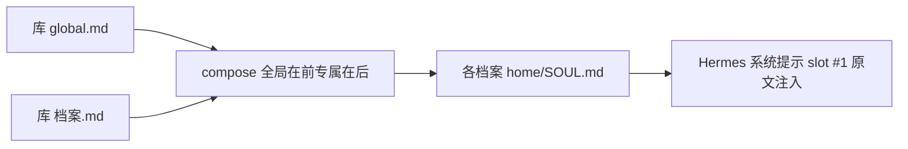
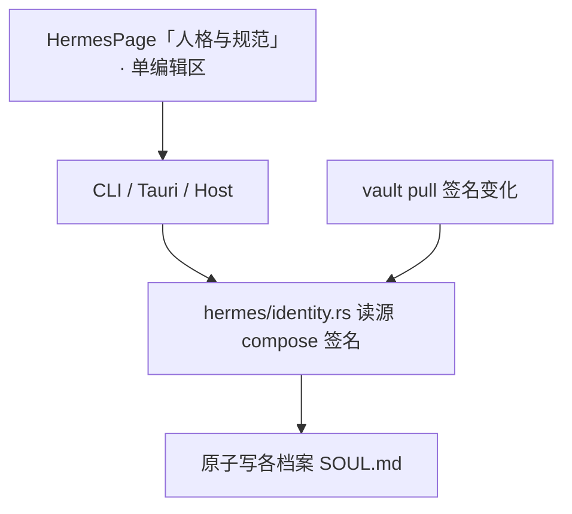

# Hermes 档案身份管理：调查与架构

**日期**：2026-11-15（Asia/Shanghai）  
**状态**：调查结论。用户倾向已采纳为**方案 1**（角色与规范都写入 `SOUL.md`）。**尚未实现、尚未写入正式规格。**

本页不是规格。落地前须走 speckit（建议 `specs/004-hermes-identity/`），并修订 002 中排除 SOUL 管理的条目。

---

## 1. 已选方案：一份 SOUL，全局 + 每 bot 合成

和现有 Agent 指令同一合同：库内维护源，保存后「全局在前、专属在后」覆盖本机各档案的 `SOUL.md`。

角色定义、行为规范、语气都写在这份 Markdown 里。**不**拆 `agent.system_prompt`，**不**写项目 `AGENTS.md`。能力层（技能）继续用现有档案中心，不进这个编辑器。

```text
SkillManagerVault/hermes-identity/
  global.md                 # 全体 bot 共用的人格 / 角色 / 规范
  <profile-id>.md           # 该 bot 补充；可空 = 只用全局
        │
        ▼  compose（与指令四态相同）
        │
        ▼  原子写入
  ~/.hermes/SOUL.md
  ~/.hermes/profiles/<id>/SOUL.md
```

`<profile-id>` 用 Hermes 目录 id（含 URL 编码名），不用显示名。文件不存在 = 空。源随库同步；上次写入哈希留本机 SQLite。



界面照抄指令编辑器：左列「全局」+ 已发现档案，右侧一个编辑区、一个保存。专属为空时提示「仅使用全局」。不做人格 / 角色 / 规范三个分段——内容由用户自己用标题组织。

---

## 2. 为什么选方案 1，而不是 GPT 的分槽

| | 方案 1（已选） | 方案 2（GPT：规范进 `agent.system_prompt`） |
|---|---|---|
| 机器人是否「看见」规范 | 会。`SOUL.md` 是系统提示第 1 槽，有内容则原文注入，替换默认人格 | 也会看见，但是另一层，且与 `/personality` 互斥 |
| 换目录是否还在 | 在。SOUL 跟档案走，不跟工作目录走 | 在 |
| 实现 | 一种 compose、一种原子写，与指令同构 | 另调 `hermes config set`、两套哈希、人格冲突警告 |
| 编辑 | 一份长 Markdown | 身份与规范两套源、两个预览 |

GPT 说对的部分仍然成立，只是**不必为此分槽**：

- 官方项目 `AGENTS.md` 确实不是 bot 常驻规范。方案 1 也不写它。
- 常驻内容必须跟档案走。`SOUL.md` 正是这个位置。官方 Prompt Assembly 把 SOUL 说成「persona **and standing behavior**」。
- 能力层仍是 `SKILL.md`，档案中心已有。

分槽要防止的后果是「模型把规范当成人格而忽略」。这是风格偏好，不是本项目已观察到的失败。宪章 VI：没有不可接受的具体后果，不加适配器。用户判断「只要能遵守，没必要分太开」——采用。

方案 2 留作后路：若实测长 SOUL 中段规范经常被截断或被忽略，再把规范迁到 `agent.system_prompt`。首期不做。

---

## 3. 合成与分发

规则与 `compose_instructions` 相同：去空白；双空→空；单侧有→只用该侧；双有→`全局\n\n专属`。读失败不得当空。

合成结果**不再加管理器标题**（由用户在源里自己写 `# 角色` / `# 规范`）。不要 HTML 注释：会进提示词。

| 时机 | 行为 |
|---|---|
| 保存任一作用域 | 写源，对**全部已发现档案**写入合成 `SOUL.md` |
| 库拉取后源签名变化 | 同上；不创建档案、不改技能名单 |
| 新发现档案 | 下次保存或拉取再写 |

`SOUL.md` 用 tmp+rename。单档案失败不中断其余。

**收编**：现网非空且不像内置 seed 的 `SOUL.md`，在该档案库内源为空时收入 `<id>.md`。未认领且磁盘有内容 → 保存前阻止覆盖。本机记 `last_dispatched_hash`，外部改过则暂停该项。

空合成且已认领 → 写空文件（Hermes 回退默认人格）。未认领 → 不写。

---

## 4. 长度：可以写长，但不是无限

Hermes 对 SOUL 做扫描后注入，超长则头 70% + 尾 20% 截断（中间插标记）。上限默认随模型窗口变：地板约 **2 万字符**，天花板 50 万；`context_file_max_chars` 可钉死。日常几千到一两万字的中文 SOUL 通常整份进入；写到数万字才需要担心中段规范被砍。分发后可在结果里标合成字符数，接近地板时警告，不做自动拆文件。

---

## 5. 明确不管

| 对象 | 原因 |
|---|---|
| `agent.system_prompt` | 方案 2，首期不做 |
| 项目 `AGENTS.md` | 跟仓库走 |
| 档案创建 / 删除 / 改名 / 活动切换 | 002 仍排除 |
| `USER.md` / `MEMORY.md` / `.env` / `auth.json` | 记忆或密钥 |
| 整份 `config.yaml` | 注释与其它键 |
| 技能正文 | 能力层已有 |

---

## 6. 模块



实现落点：`crates/core/src/hermes/identity.rs`；CLI `hermes identity get|set|import|distribute`；前端新组件，不扩 `InstructionEditor`。设计层先改原型。

---

## 7. 范围与工作量（只改 SOUL）

用户 2026-11-15 再收窄：**暂时只管理 `SOUL.md`。** 不改 `config.yaml`、`agent.system_prompt`、`profile.yaml`、`.env`、技能启停、档案生命周期。角色和规范作为用户写在 SOUL 正文里的内容，不单独建源文件或分段。

复杂度：**中低**。不是新架构，是把已交付的指令管道（T069–T072）换目标路径。侵入点少，现有档案技能启停可以不动。

对照物：`vault/instructions.rs` 约 300 行、`InstructionEditor.tsx` 约 230 行、CLI `instruction.rs`、Tauri 薄封装、`pull.rs` 一段签名刷新。SOUL 版几乎同构，多两件指令没有的事：现网 `SOUL.md` 收编、外部修改暂停。

| 块 | 动什么 | 体量 |
|---|---|---|
| 规格 | 修订 002 的 FR-028 / US6-6 / FR-043 末句、data-model、CLI 契约、需求记录。不新开 004（只加档案中心一项能力，不必新功能目录） | 小，但必须先做，否则实现与现行排除条款冲突 |
| core | 新 `hermes/identity.rs`：源读写、四态 compose、原子写 `SOUL.md`、签名 | 与 `instructions.rs` 同级 |
| 收编 / 暂停 | 磁盘已有 SOUL 导入；`last_dispatched_hash` | 比指令多的主要风险点 |
| CLI / Tauri / Host | `hermes identity get\|set\|import\|distribute`，规则在 core | 薄，但三条入口都要有（宪章 V） |
| 界面 | 档案页一个按钮 + 克隆指令编辑器（左全局/档案，右一块文本，一个保存） | 主要可见工作；须改原型再改 React |
| 同步 | `pull.rs` 在身份源签名变化时分发 | 在指令刷新旁加一段 |

**不做（本轮）**：`config.yaml` 任何键、显示名编辑、人格预设、项目 `AGENTS.md`、Markdown 预览/历史。

主要风险不是算法，是第一次写入会不会覆盖现网人格——收编和哈希暂停就是为这个。合成本身无新发明。

---

## 8. 待核对（实现前）

- 本机默认人格全文（判断 seed）。
- 发行版锁定的 SOUL 是否出现（有则拒绝覆盖）。
- Windows 档案 home。
- 用户是否确认：分发全部已发现档案；现网 SOUL 自动收编非 seed。

---

## 9. 规格修订清单（落地时做）

002 FR-028 / US6-6、需求记录、H02、GLOSSARY、ADR 0001、hermes-integration、CLI 契约。本调查不改正式规格。
