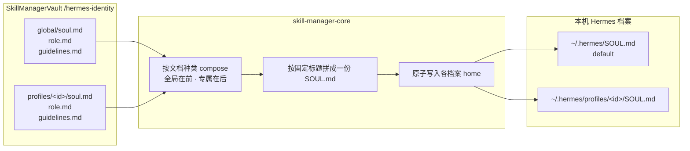
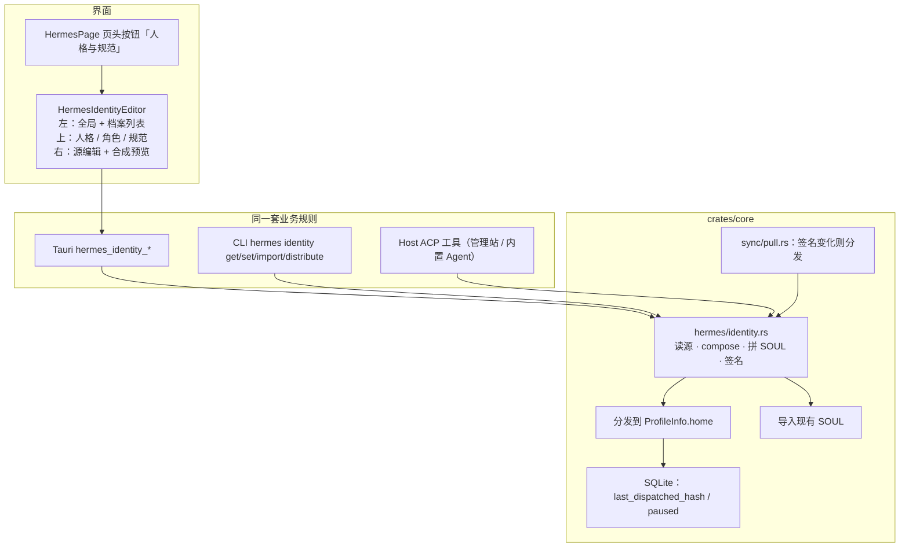

# Hermes 档案身份管理：调查与架构

**日期**：2026-11-15（Asia/Shanghai）  
**状态**：调查结论与推荐架构，**尚未实现、尚未写入正式规格**。  
**范围**：在现有 Hermes 档案中心为每个 bot 管理 SOUL、角色、行为规范，以及后续的非密钥配置；源内容进库，保存后自动合并写入该 bot。

本页不是规格。落地前须走 speckit（建议新功能目录 `specs/004-hermes-identity/`），并修订 002 中明确排除 SOUL 管理的条目。

---

## 1. 结论先行

和现有 **Agent 指令** 同一套「库内源 → 本机合成覆盖」模型，**不要**在档案 home 里直接当唯一真值编辑 `SOUL.md`。

原因：Hermes 每个档案是一座岛，官方只从该档案 `HERMES_HOME/SOUL.md` 读人格，**没有**「全局 SOUL + 档案 SOUL」的原生合并。全局与专属只能由 Skill Manager 在库内维护，合成后再写入每个档案的 `SOUL.md`。这与 `instructions/global.md` + `instructions/<agent>.md` → 覆盖各工具 `AGENTS.md` 同构。

| 用户说法 | 落到 Hermes 的真实文件 | Skill Manager 怎么管 |
|---|---|---|
| SOUL / 人格 | `<档案 home>/SOUL.md`（系统提示 slot #1，原文注入） | 库内 `soul.md`：全局 + 每档案，合成后写入该文件 |
| 角色 | Hermes **没有**独立 `IDENTITY.md`；Bot 显示名在 `profile.yaml` 的 `ui_meta.hermes-bots.title` | 库内 `role.md` 合成进 `SOUL.md` 的「角色」段；显示名仍读 `profile.yaml`，改名作为二期 |
| 行为规范 | Hermes 的 `AGENTS.md` 是**项目工作目录**文件，不是档案人格 | 库内 `guidelines.md` 合成进同一份 `SOUL.md`；**不要**去写项目 `AGENTS.md` |
| 配置 | `<档案 home>/config.yaml`（模型、工具、网关等） | **不要整份重写**。二期用非密钥 overlay，经 `hermes -p <档案> config set` 应用 |

**首期只做三份 Markdown 源（人格 / 角色 / 行为规范）的全局+专属合成，写入各档案 `SOUL.md`。** 配置、显示名、记忆文件、密钥、档案生命周期继续排除。

---

## 2. 现状（以仓库与官方文档为准）

### 2.1 档案中心现在做什么

`HermesPage` 只管理**技能启停、浏览、收编**。页头注释与 CLI `hermes` 子命令都写明：不做档案创建/删除/改名、活动切换、多实例或 `SOUL.md` 管理。core 发现档案时会**读** `profile.yaml` 标题和 `SOUL.md` 首个 `# ` 标题作显示名，但**不暴露、不写入**正文。

规格锚点：

- 002 `FR-028` / US6 场景 6：排除 `SOUL.md` 管理。
- 002 `FR-043` 末句：指令管理与 Hermes 档案指令互不扩展。
- 需求记录：暂不把各档案 `SOUL.md` 等角色与行为指令纳入范围。
- research.md §5.4：本项目**不写**用户 `config.yaml`（约 12 万字节、含大量注释；Hermes 用 ruamel 保注释；整份重写会破坏其它设置）。

这些是**当时的范围裁决，不是永久禁令**（宪章与 `AGENTS.md` 均如此）。本次需求等于明确要打开 SOUL / 角色 / 行为规范这一块。

### 2.2 可复用的指令系统

`skill-manager/crates/core/src/vault/instructions.rs`：

```text
SkillManagerVault/instructions/
  global.md
  <agent-key>.md
        │
        ▼  compose：全局在前、专属在后、空行分隔；单侧空则只用另一侧
        │
        ▼  覆盖本机已启用且已检测 Agent 的 <detect_dir>/AGENTS.md
```

保存立即分发；库拉取后若源签名变化，再分发一次。不新增启用目标。真正读失败与「文件不存在」分开，避免把失败当成清空。

Hermes 身份应**复制这套服务形态**，不要把 Code Agent 的 `InstructionEditor` 直接扩到 Hermes（与 FR-043「互不扩展」一致：两套源、两套目标）。

### 2.3 Hermes 实际加载什么

官方对照（2026-11 文档，实施前须再核对用户本机 Hermes 版本）：

| 文件 | 作用 | 位置 | 谁写 |
|---|---|---|---|
| `SOUL.md` | 人格 / 语气 / 风格，系统提示第 1 槽，**原文注入** | 档案 `HERMES_HOME`，不扫工作目录 | 用户（缺省时 Hermes 会 seed，从不覆盖已有文件） |
| `USER.md` | 用户画像 | `memories/` | **Agent 经 memory 工具** |
| `MEMORY.md` | Agent 笔记 | `memories/` | **Agent 经 memory 工具** |
| `AGENTS.md` / `.hermes.md` | 项目约定 | **项目工作目录** | 用户 / 仓库 |
| `config.yaml` | 模型、工具集、网关等 | 档案 home | 用户 / `hermes config set` |
| `.env` | API 密钥、bot token | 档案 home | 用户（chmod 600） |
| `profile.yaml` | Bot Mode 展示（title 等） | 档案 home | Hermes 面板 |
| `auth.json` / `state.db` | 登录与运行状态 | 档案 home | Hermes |

缺文件或空 `SOUL.md` 时，Hermes 回退内置默认人格。有内容则**整份替换**默认人格，不是叠加。改文件后下一条新会话生效，一般不必重启网关；长会话可用 `hermes sessions refresh-prompts`。

Soul Spec 一类的 `IDENTITY.md` / `STYLE.md` 在 Hermes 侧会被**合并进 `SOUL.md`**。本产品不必再发明第三份 Hermes 不读的文件。

### 2.4 与 2026-11-12 旧调查的差异

From Hindsight memory: 此前有一条「每 bot 一个大 textarea 直接读写 `SOUL.md`」的路线，且建议新开 `specs/003-hermes-soul/`。

那条路线**不能满足**本次「全局 + 每 bot、保存后自动合并」的要求，而且 `specs/003-host-station-agent/` 已被占用。本次以库内源 + 合成为准，功能目录用 **004**。

---

## 3. 推荐架构：档案身份源（Hermes Identity Sources）

### 3.1 一句话

库里维护「全局 + 每档案」的身份源；本机按已发现档案合成，覆盖写入各档案 `SOUL.md`。技能启用名单、密钥、记忆仍是本机 / Hermes 自己的事。

### 3.2 库内布局（共享资产）

```text
SkillManagerVault/
  instructions/                 # 已有：Code Agent 指令（不动）
  hermes-identity/              # 新增：Hermes 档案身份源
    global/
      soul.md                   # 全局人格
      role.md                   # 全局角色底稿（可空）
      guidelines.md             # 全局行为规范
    profiles/
      <profile-id>/             # 与 Hermes 目录 id 一致（含 URL 编码名）
        soul.md
        role.md
        guidelines.md
```

- 文件不存在 = 该侧空内容（与指令相同）。
- `<profile-id>` 用档案目录名（`default`、`blank`、`u7ed8-u753b-u52a9-u624b`），**不用**显示名，避免跨机改名后对不上。
- 不把 `SOUL.md` 正文放进 SQLite。身份源随库 Git 同步（ADR 0001：共享内容进库）。
- 分发记录（上次写入哈希、暂停原因）进本机 SQLite，与部署记录同类。

二期若做配置 overlay，另加 `global/config.yaml` 与 `profiles/<id>/config.yaml`，只含非密钥键；仍不把 `.env` 放进库。

### 3.3 数据流



### 3.4 合成规则（Markdown）

每种文档独立合成，规则与指令四态相同：

1. 两侧去首尾空白。
2. 双空 → 空；单侧有内容 → 只用该侧；双有 → `全局\n\n专属`。
3. 读失败（非 NotFound）必须报错，**不得**当成空内容继续覆盖。

然后按固定标题拼成 Hermes 真正加载的那一份 `SOUL.md`：

```markdown
# 角色

<合成后的 role>

# 人格

<合成后的 soul>

# 行为规范

<合成后的 guidelines>
```

空段整段省略。三段都空时：若用户明确保存过空源，则写入空文件（Hermes 回退默认人格）；若从未认领该档案，则**不写**，避免抹掉 Hermes seed 或用户手改。

标题用中文、固定字符串，便于人读，也便于模型区分「大家都要遵守的规范」和「这个 bot 的人格」。不要用 HTML 注释作管理标记：Hermes 原文注入，注释会进提示词。

**不要**把专属内容盖掉全局（覆盖语义）。行为规范的本意是「全体 bot 都要遵守，专属再补充」；覆盖会让专属 bot 丢掉全局安全/语气底线。若某 bot 必须取消某条全局规范，应在专属里显式写「忽略全局某某条」，而不是换合成算法。

### 3.5 分发范围与时机

| 时机 | 行为 |
|---|---|
| GUI / CLI 保存任一作用域 | 写源，立即对**本机已发现的全部档案**分发（含 default） |
| 库拉取后源签名变化 | 同样全量刷新，不创建档案、不改技能启用名单 |
| 新发现的档案 | 下次保存或拉取时写入；不在发现时偷偷写 |

分发目标是「本机已发现档案」，不是「当前下拉选中的那一个」。全局规范必须落到每个 bot。某档案本次写入失败不中断其余，逐项报告（与指令相同）。

写入用同目录 tmp + `rename` 原子替换（Hermes 自己写 SOUL 也是这一套）。

### 3.6 已有 SOUL 的收编（必须做，否则第一次分发会覆盖人格）

用户现网档案里已经有 `SOUL.md`。若库内该档案 `soul.md` 为空就按「仅全局」覆盖，会丢掉现有人格。

推荐：**首次认领**时，若库内该档案三种源都空、且磁盘 `SOUL.md` 非空且不像 Hermes 内置 seed，则把磁盘全文收进 `profiles/<id>/soul.md`，再合成。提供显式 CLI/按钮「从档案导入」，GUI 保存前若检测到未认领的非空 SOUL，阻止覆盖并提示导入。

本机状态记 `last_dispatched_hash`。磁盘文件与哈希不一致 → **暂停覆盖**并如实报告（复用部署 `paused_local_change` 的诚实表达，不在 GUI 做 diff 合并）。

### 3.7 明确不管

| 对象 | 原因 |
|---|---|
| 档案创建 / 删除 / 改名 / 活动切换 / 多实例 | 002 仍排除；本次只加身份内容 |
| `USER.md` / `MEMORY.md` | Agent 自己维护的记忆，当源会和 memory 工具打架 |
| `.env` / `auth.json` / bot token | 密钥，不进 SkillManagerVault |
| 项目 `AGENTS.md` | 属于仓库工作目录，不是档案人格；Code Agent 指令系统已经管各工具的 `AGENTS.md` |
| 整份重写 `config.yaml` | research.md §5.4 已否决 |
| Markdown 预览、版本历史、注入扫描 | 避免复制 Hermes 自己的机制（宪章 VI） |

---

## 4. 模块分层



建议实现落点：

- **core**：`crates/core/src/hermes/identity.rs`（贴近档案发现，不放进 `vault/instructions.rs`）。
- **CLI**：`hermes identity get|set|import|distribute`，不要新的顶层 `soul` 命令。
- **Tauri / Host**：薄封装，规则全在 core。
- **前端**：新组件 `HermesIdentityEditor`，入口在 `HermesPage` 档案选择器旁；**不要**复用页头「Agent 指令」对话框。
- **设计层**：先改 `ui-prototype` 档案页与新对话框，再按 frontend-design 技能对齐正式界面。

配置二期若做：独立 `hermes/config_overlay.rs`，经 `hermes -p <id> config set` 写键，禁止密钥形键名（`token` / `api_key` / `secret` / `password` 等）。

---

## 5. 界面

沿用指令编辑器的交互合同，换数据源：

- 左列固定「全局」，下列本机已发现档案（显示名，内部仍用 profile id）。
- 文档种类用顶部分段：人格 / 角色 / 行为规范。
- 右侧**只编辑当前作用域的源**，不是合成结果。专属为空时提示「仅使用全局」。
- 底部一个「保存」：写当前源并分发全部档案。保存后保持打开，切换作用域保留草稿。
- 展示合成预览（只读），让用户看见将写入 `SOUL.md` 的全文。
- 单档案失败列在结果里，不中断其它档案。

不做独立「分发」按钮、不分发勾选（与指令同一产品决定）。

---

## 6. 和指令系统对照

| | Agent 指令 | Hermes 身份（推荐） |
|---|---|---|
| 库目录 | `instructions/` | `hermes-identity/` |
| 作用域 | `global` + Agent key | `global` + 档案 id |
| 源文件 | 每种作用域一个 md | 每种作用域 × 三种文档 |
| 合成 | 一种流 | 三种流，再拼成一份 SOUL |
| 目标 | 已启用已检测 Agent 的 `AGENTS.md` | 已发现档案 home 的 `SOUL.md` |
| 空内容 | 允许，覆盖目标 | 允许；未认领则不覆盖磁盘 |
| 拉取刷新 | 源签名变化则分发 | 同样 |
| 密钥 | 无 | 永不入库 |
| GUI 入口 | 全局页头「Agent 指令」 | 档案页「人格与规范」 |

---

## 7. 配置管理（二期，不进首期）

用户提到「配置管理」。当前硬约束是：**不能整份重写 `config.yaml`**。

推荐适配：

1. 库内只存**非密钥 overlay**（例如 `model.default`、工具开关这类用户点名的键）。
2. 合并：全局键 + 档案键，档案覆盖同名键。
3. 应用：调用本机 `hermes -p <id> config set <key> <value>`（或等价入口），让 Hermes 自己保注释、做校验。
4. 拒绝密钥形键；`.env`、平台 token、`auth.json` 永远不进库、不经本 overlay。

在用户列出「到底要同步哪些配置键」之前，不要做通用 YAML 编辑器。

显示名（`profile.yaml` 的 title）可作配置二期的一个小项：独立读写该键，不碰其余 YAML。首期继续只读。

---

## 8. 建议分期（实现时，不是本调查的工作）

| 阶段 | 内容 |
|---|---|
| 0 规格 | `specs/004-hermes-identity/`：specify → clarify → checklist；修订 002 的 FR-028、US6-6、FR-043 末句、Assumptions；需求记录补一节。**003 已被 Host/管理站占用。** |
| 1 core | 源读写、三种 compose、拼 SOUL、签名、原子写、测试四态与读失败 |
| 2 认领 | 导入现有 SOUL；`last_dispatched_hash`；外部修改暂停 |
| 3 入口 | CLI + Tauri + Host 工具 |
| 4 界面 | 设计层原型 + `HermesIdentityEditor` + 档案页入口 |
| 5 同步 | `sync/pull.rs` 在身份源签名变化时分发 |
| 6 配置（可选） | overlay + `hermes config set`；`profile.yaml` 显示名 |

每阶段仍须 GUI 与 CLI 同一规则（宪章 V）。

---

## 9. 规格与文档修订清单（落地时做）

| 文件 | 修订 |
|---|---|
| `specs/002-skill-management/spec.md` | FR-028 / US6-6 去掉 SOUL 排除；FR-043 改为「Code Agent 指令与 Hermes 身份源分轨」 |
| `docs/requirements.md` | 撤回「暂不管理 SOUL」并记录新裁决 |
| `docs/legacy-skill-capabilities.md` H02 | 同步裁决 |
| `GLOSSARY.md` | 增加「档案身份源」 |
| `docs/adr/0001-library-and-local-state.md` | 身份源进库；分发哈希留本机 |
| `docs/technical-reference/hermes-integration.md` | 从「不编辑 SOUL」改为「由身份源分发」 |
| CLI 契约 / data-model / 维护 Skill | 新命令与目录 |

本调查**不改**上述正式规格，避免把草案写成已定案。

---

## 10. 待用户拍板（实现前）

1. **首期三种 Markdown（人格 / 角色 / 行为规范）是否一次做完**，还是先做人格+规范、角色并入人格？
2. **已有 `SOUL.md`：自动收编进专属源，还是保存前强制确认？** 建议自动收编非 seed 文件，并在结果里写明。
3. **分发范围确认**：本机全部已发现档案（推荐），还是仅当前选中档案？
4. **配置 overlay 要哪些键？** 没有清单则首期不做配置。
5. **空合成是否允许把磁盘 SOUL 写成空**（触发 Hermes 默认人格）？建议：仅当该档案已被认领且用户清空源。

---

## 11. 实施时必须再核对的 Hermes 事实

- 当前安装是否仍只从 `HERMES_HOME/SOUL.md` 读人格（官方 2026-11 如此）。
- 内置默认人格全文（用于判断 seed，避免把 seed 收编成「用户专属」）。
- `hermes config set` / `hermes sessions refresh-prompts` 在目标版本是否仍可用。
- Windows 下档案 home 是否仍为 `%LOCALAPPDATA%/hermes`。
- 发行版锁定的 `SOUL.md`（`hermes profile install <git-url>`）是否出现在本机；若出现须拒绝覆盖并报告。
