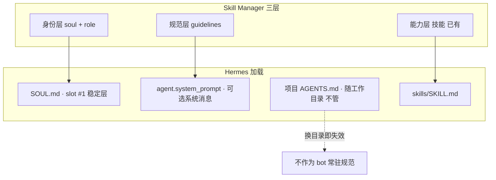
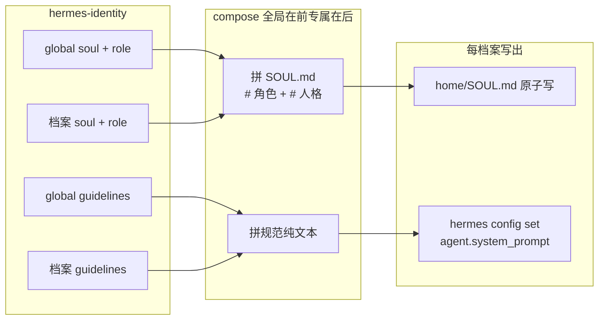
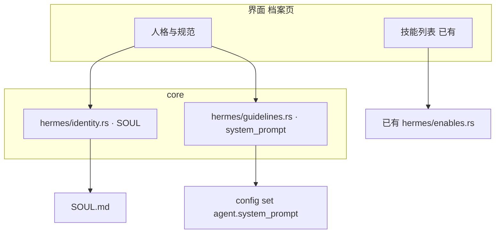

# Hermes 档案身份管理：调查与架构

**日期**：2026-11-15（Asia/Shanghai），同日按 GPT 三层建议修订  
**状态**：调查结论与推荐架构，**尚未实现、尚未写入正式规格**。  
**范围**：在现有 Hermes 档案中心管理每个 bot 的身份（SOUL / 角色）与常驻行为规范；源内容进库，保存后自动合并写入该 bot。能力层（技能）已由档案中心管理，不另建一套。

本页不是规格。落地前须走 speckit（建议 `specs/004-hermes-identity/`），并修订 002 中明确排除 SOUL 管理的条目。

---

## 1. 结论先行

产品按 **三层** 对齐 Hermes 真实加载槽，不要把规范塞进 `SOUL.md`，也不要把规范写成项目 `AGENTS.md`。

| 层 | 管什么 | 库内源（全局 + 每档案） | 写入 Hermes 的位置 | 本产品现状 |
|---|---|---|---|---|
| **身份** | 这个 bot 是谁、职责、判断原则、语气 | `soul.md` + `role.md` | `<档案 home>/SOUL.md`（系统提示 slot #1） | 未做 |
| **规范** | 无论在哪个目录、做什么任务都要遵守的操作规则、哪些事要确认 | `guidelines.md` | 该档案 `config.yaml` 的 **`agent.system_prompt`**（经 `hermes config set`，不整份重写配置） | 未做 |
| **能力** | 某类任务用什么方法与步骤 | 技能库 + 档案启用名单 | `<档案>/skills/` 下的 `SKILL.md` | **已有**（档案中心） |

合成合同仍复制 Agent 指令：库内源是真值；每种文档「全局在前、专属在后」；保存后分发到本机已发现档案。身份与规范 **分文件写出**，因为 Hermes 在提示词里把它们放在不同层。

GPT 建议里正确的部分：官方 `AGENTS.md` 只是项目上下文，VPS 机器人换目录就会丢；常驻规范应走配置里的全局指令槽。需要补上的限制：`agent.system_prompt` 在选了 `/personality` 时会被人格 overlay 盖掉；写入必须走 Hermes 自己的 `config set`，不能用本项目 YAML 库整份保存 `config.yaml`。



---

## 2. 对 GPT 建议的采纳

用户转述（2026-11-15）：

- 官方 `AGENTS.md` 是项目上下文，不是对整个 Bot 永久生效的全局规则。
- VPS 机器人无论在哪个目录都应遵守的操作规范，应考虑 `config.yaml` 的 `agent.system_prompt`，而不是只依赖某项目目录里的 `AGENTS.md`。
- 建议三层：身份（`SOUL.md`）/ 规范（全局指令 + 项目 `AGENTS.md`）/ 能力（`SKILL.md`）。

采纳与修正：

| GPT 说法 | 本项目裁决 |
|---|---|
| 不要用项目 `AGENTS.md` 当 bot 常驻规范 | **采纳**。档案中心不写、不管理各仓库 `AGENTS.md`。Code Agent 指令系统继续管各编码工具自己的 `AGENTS.md`，与 Hermes bot 分轨。 |
| 常驻规范写入 `agent.system_prompt` | **采纳**。规范源仍在库里合成，分发时对该档案执行 `hermes -p <id> config set agent.system_prompt …`（或等价、保注释的单键写入）。 |
| 身份 = `SOUL.md`（是谁、职责、判断原则） | **采纳**。库内 `soul.md` + `role.md` 合成进 `SOUL.md`，**不再**把行为规范拼进同一文件。 |
| 能力 = `SKILL.md` | **采纳且已存在**。档案中心已经管技能启停与内容；本功能不重复做技能编辑。 |
| 规范层同时包括项目 `AGENTS.md` | **产品不管项目文件**。项目约定留给仓库作者；管理器只保证 bot 常驻规范跟档案走。 |

先前草案曾把三种 Markdown 全部拼进一份 `SOUL.md`。那会把「是谁」和「必须遵守的操作规则」混在 identity slot，也用不上 Hermes 已有的 `agent.system_prompt`。**已作废。**

---

## 3. 现状（仓库 + 官方文档）

### 3.1 档案中心现在做什么

`HermesPage` 只管理**技能启停、浏览、收编**（能力层）。页头注释与 CLI 写明：不做档案生命周期或 `SOUL.md` 管理。显示名只读 `profile.yaml` / `SOUL.md` 标题。

规格锚点：002 `FR-028` / US6-6 排除 SOUL；`FR-043` 末句指令不扩展到 Hermes；research.md §5.4 **不整份写** `config.yaml`。这些是当时范围，不是永久禁令。

### 3.2 可复用的指令系统

`instructions/global.md` + `<agent>.md` → compose → 覆盖已启用 Agent 的 `AGENTS.md`。保存即分发；拉取后源签名变化再分发。读失败不得当成空。Hermes 身份 **复制服务形态**，不把 `InstructionEditor` 扩到 Hermes。

### 3.3 Hermes 提示词里这三层实际怎么排

官方 Prompt Assembly（2026-11，实施前须对用户本机版本再核）：

1. **稳定层首位**：`SOUL.md`（缺则内置默认人格），原文注入。
2. **可选系统消息**：配置或 API 的 system message —— 对应 `agent.system_prompt`（`hermes config set agent.system_prompt` 已入 schema，PR nousresearch/hermes-agent#80681）。
3. **项目上下文**（换工作目录会变）：`.hermes.md` / `AGENTS.md` / … 只取一种。
4. **技能索引**：档案 `skills/` 里已启用的 `SKILL.md` 摘要；正文按任务再加载。

`agent.system_prompt` 的限制（必须写进规格）：

- 它是**用户手写的常驻 overlay**，人格预设代码不应改它（#81791 曾出现选 personality 覆盖该键，上游已修；本机版本若未修须检测并警告）。
- 解析顺序：若 `display.personality` 选了具名人格，会话 overlay **用人格文本，不用** `agent.system_prompt`。依赖管理器规范的 bot **不要同时开 `/personality`**；分发后若发现人格已选，如实警告「规范槽被人格 overlay 盖住」。
- 写入只用 Hermes 单键 API，禁止本项目整份重写 12 万字节配置。

---

## 4. 推荐架构

### 4.1 库内布局

```text
SkillManagerVault/
  instructions/                 # 已有：Code Agent 指令（不动）
  hermes-identity/
    global/
      soul.md                   # 全局人格 / 判断原则
      role.md                   # 全局角色底稿（可空）
      guidelines.md             # 全局常驻操作规范
    profiles/
      <profile-id>/             # Hermes 目录 id，含 URL 编码名
        soul.md
        role.md
        guidelines.md
```

文件不存在 = 该侧空。id 不用显示名。源随库同步；各档案上次分发哈希、暂停原因留本机 SQLite。

其它配置键（模型、工具开关等）仍等用户给出清单后再做 overlay，不与规范槽绑在一起。

### 4.2 数据流



### 4.3 合成规则

每种文档独立，指令四态：去空白；双空→空；单侧有→只用该侧；双有→`全局\n\n专属`。读失败必须报错。

**身份 → `SOUL.md`：**

```markdown
# 角色

<合成 role>

# 人格

<合成 soul>
```

空段省略。身份两侧都空且已认领 → 写空文件（Hermes 回退默认人格）。未认领 → 不写。

**规范 → `agent.system_prompt`：**

只写入合成后的纯文本，**不加**「行为规范」这种身份标题（该键本身就是规范槽）。两边都空且已认领 → `config set` 成空字符串。未认领 → 不改该键。

专属是补充不是覆盖。某 bot 要取消某条全局规范，在专属里写明「忽略全局某某条」。

### 4.4 分发

| 时机 | 行为 |
|---|---|
| 保存任一身份或规范源 | 写源，对**全部已发现档案**分发身份文件 + 规范键 |
| 库拉取后源签名变化 | 同上，不创建档案、不改技能名单 |
| 新发现档案 | 下次保存或拉取再写 |

单档案失败不中断其余。`SOUL.md` 用 tmp+rename。`agent.system_prompt` 调用本机 `hermes` CLI（`HERMES_HOME` / `-p` 指向该档案），失败则报告命令输出，不回退成整文件 YAML 写入。

### 4.5 收编现网内容

第一次分发前必须认领：

- 磁盘 `SOUL.md` 非空且不像内置 seed → 收入该档案 `soul.md`。
- 已有非空 `agent.system_prompt` → 收入该档案 `guidelines.md`。
- 保存前若未认领且磁盘有内容 → 阻止覆盖并提示导入。

本机分别记 `soul_hash` 与 `prompt_hash`。外部改了 `SOUL.md` 或该配置键 → 暂停覆盖该项，其它层仍可更新。

### 4.6 明确不管

| 对象 | 原因 |
|---|---|
| 档案创建 / 删除 / 改名 / 活动切换 | 002 仍排除 |
| 项目 `AGENTS.md` / `.hermes.md` | 跟仓库走，不是 bot 常驻规范 |
| `USER.md` / `MEMORY.md` | Agent 自维护 |
| `.env` / `auth.json` / bot token | 密钥 |
| 整份 `config.yaml` | 注释与其它键会被毁掉 |
| `/personality` 预设编辑 | 与规范槽互斥；只警告，不替用户关人格 |
| 技能正文编辑 | 能力层已有：去技能库编辑、档案页启停 |

---

## 5. 模块分层



- core 分两个写出适配器，合成函数共用（与 `compose_instructions` 同形）。
- CLI：`hermes identity …` 与 `hermes guidelines …`，或同一 `hermes identity` 下用 `--kind soul|role|guidelines`。
- 规范写出依赖本机 `hermes` 可执行文件；缺失时该项失败并说明，不假装已写入配置。
- 前端仍是一个编辑器：左全局+档案，上「人格 / 角色 / 规范」，保存后按当前种类分发对应槽；预览显示将写入的 `SOUL.md` 或 `agent.system_prompt` 文本。

---

## 6. 界面

交互对齐指令编辑器：单编辑区、单保存、切换保留草稿。种类分段为人格 / 角色 / 规范。规范选中时注明「写入该 bot 的 agent.system_prompt，换目录也仍生效；项目 AGENTS.md 不管」。若该档案 `display.personality` 非空，显示警告。

能力层继续用现有档案技能列表，不塞进这个对话框。

---

## 7. 和指令系统对照

| | Agent 指令 | Hermes 身份+规范 |
|---|---|---|
| 库目录 | `instructions/` | `hermes-identity/` |
| 作用域 | `global` + Agent key | `global` + 档案 id |
| 源 | 每作用域一个 md | 每作用域 × soul / role / guidelines |
| 目标 | 工具 `AGENTS.md` | `SOUL.md` **和** `agent.system_prompt` |
| 项目 AGENTS.md | 正是目标 | **不是**目标 |
| 能力 | 另页部署技能 | 档案中心已有启停 |

---

## 8. 其它配置（仍二期）

`agent.system_prompt` 已是规范层的一等目标，不等于开放整份配置编辑。模型、工具集、网关等仍要用户列出键再做 overlay。显示名（`profile.yaml` title）仍只读，改名二期。

---

## 9. 分期

| 阶段 | 内容 |
|---|---|
| 0 规格 | `specs/004-hermes-identity/`；修订 002 FR-028、US6-6、FR-043 末句 |
| 1 身份 | soul/role 源、compose、原子写 `SOUL.md`、导入、哈希暂停 |
| 2 规范 | guidelines 源、compose、`hermes config set agent.system_prompt`、导入现有键、人格冲突警告 |
| 3 入口 | CLI + Tauri + Host |
| 4 界面 | 设计层 + 档案页编辑器 |
| 5 同步 | pull 时身份与规范源签名变化则分发 |
| 6 其它配置 | 可选 overlay；显示名 |

能力层不排期。规范依赖本机 Hermes CLI，可与身份并行设计、分步验收。

---

## 10. 规格修订清单（落地时做）

与前一稿相同：002 FR-028 / US6-6、需求记录、H02、GLOSSARY、ADR 0001、hermes-integration、CLI 契约。另须写明：规范目标是 `agent.system_prompt`，不是 `SOUL.md`，也不是项目 `AGENTS.md`。

本调查不改正式规格。

---

## 11. 待用户拍板

1. **身份 + 规范是否一次规格做完**（推荐一次定稿，实现仍可分 1/2 阶段验收）。
2. 现网 `SOUL.md` 与已有 `system_prompt`：自动收编非 seed / 非空值（推荐），还是保存前强制确认。
3. 分发全部已发现档案（推荐），还是仅当前选中档案。
4. 选了 `/personality` 的档案：只警告（推荐），还是分发时拒绝写规范键。
5. 其它配置键清单仍空则不做通用配置编辑。

---

## 12. 实施前再核的 Hermes 事实

- 本机版本中 `agent.system_prompt` 是进缓存系统提示（Prompt Assembly Layer 4）还是仅 ephemeral overlay。
- 本机是否仍有「选 personality 覆盖 system_prompt」的旧 bug。
- `hermes -p <id> config set agent.system_prompt` 对多行文本、空字符串的写法。
- 内置默认 `SOUL.md` 全文（判断 seed）。
- Windows 档案 home、发行版锁定的 SOUL。
